# Laporan Mid-Project Jaringan Komputer

### Implementasi Jaringan Smart City Kota Surabaya

### Komunikasi Data & Jaringan Komputer 2026/2027

**Kelompok:** K-1 **Base IP Kelompok:** `10.8.0.0/16` **Skema yang dipakai:** VLSM **Domain internal:** `k1.smartcity.lab` **Tools:** Cisco Packet Tracer 9.0.1

> Muhammad Satrio Utomo \| NRP 5027251022

> Azita Zahwa Zahida Asmoro \| NRP 5027251058

> Atik Putri Matulina \| NRP 50227251128

---

## Daftar Isi

- [Ringkasan Topologi & Tabel Pengalamatan IP](#ringkasan-topologi--tabel-pengalamatan-ip)
  - [Alasan Memilih VLSM](#alasan-memilih-vlsm)
  - [Tabel VLSM](#tabel-vlsm)
  - [Link Backbone & Alamat Tambahan](#link-backbone--alamat-tambahan)
  - [Tabel Port Router](#tabel-port-router)
  - [Alamat Statis](#alamat-statis)
- [Panduan Dasar Packet Tracer](#panduan-dasar-packet-tracer)
- [Soal 1 – Perancangan Topologi](#soal-1)
- [Soal 2 – Tabel Subnetting](#soal-2)
- [Soal 3 – Static Routing](#soal-3)
- [Soal 4 – DHCP](#soal-4)
- [Soal 5 – NAT](#soal-5)
- [Soal 6 – Tunnel GRE](#soal-6)
- [Soal 7 – Dynamic Routing OSPF](#soal-7)
- [Soal 8 – Layanan Aplikasi Smart City](#soal-8)
- [Kendala & Solusi](#kendala--solusi)

---

## Ringkasan Topologi & Tabel Pengalamatan IP

[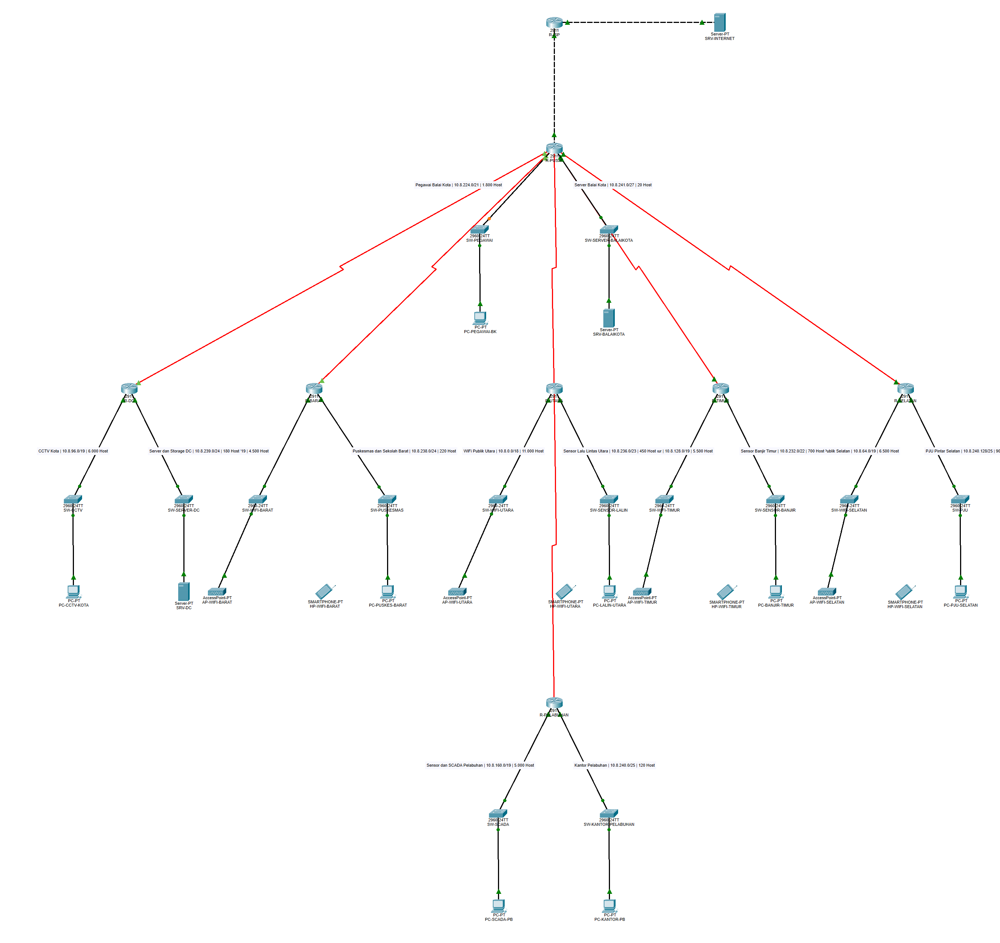](Screenshot/soal-1/topologi.png) *Topologi lengkap K1: R-ISP dan SRV-INTERNET di atas, R-PUSAT (Balai Kota) di tengah, lima router wilayah di bawahnya, dan R-PELABUHAN di bawah R-UTARA. Garis serial = backbone L1–L6, kabel tembaga = link ke ISP, setiap LAN diberi label nama subnet, network ID/prefix, dan jumlah host sesuai soal.*

### Alasan Memilih VLSM

Kebutuhan seluruh LAN dan link adalah **61.736 alamat**, yaitu **94,2%** dari blok `10.8.0.0/16` (65.536 alamat). Ruang sisa hanya 3.800 alamat.

- **VLSM** (urut dari kebutuhan host terbesar) memberi setiap subnet blok terkecil yang cukup, sehingga semuanya muat di dalam `/16`.
- **CIDR berbasis topologi** (setiap router bisa diringkas menjadi satu supernet) **tidak muat** di `/16`. Contoh: R-DC, R-BARAT, R-TIMUR, R-SELATAN, dan R-PELABUHAN masing-masing punya satu LAN `/19` ditambah LAN kecil, jadi supernet tiap router minimal `/18` (16.384 alamat). Lima router × `/18` = 81.920 alamat, sudah lebih besar dari `/16`, belum termasuk sisi R-UTARA yang berisi WiFi Utara `/18`.

Karena itu file Packet Tracer dibangun dengan skema **VLSM**. Tabel CIDR tetap dibuat di spreadsheet (soal 2) sesuai lembar UTS, termasuk **tabel revisi 11 baris** dari kertas folio UTS.

### Tabel VLSM

Diurutkan dari kebutuhan host terbesar. Gateway setiap LAN = host pertama.

| Subnet | Router | Kebutuhan Host | Network ID | Prefix | Subnet Mask | Range Host | Broadcast | Gateway | Kapasitas |
| --- | --- | --- | --- | --- | --- | --- | --- | --- | --- |
| WiFi Publik Utara | R-UTARA | 11.000 | `10.8.0.0` | /18 | `255.255.192.0` | `10.8.0.1` – `10.8.63.254` | `10.8.63.255` | `10.8.0.1` | 16.382 |
| WiFi Publik Selatan | R-SELATAN | 6.500 | `10.8.64.0` | /19 | `255.255.224.0` | `10.8.64.1` – `10.8.95.254` | `10.8.95.255` | `10.8.64.1` | 8.190 |
| CCTV Kota | R-DC | 6.000 | `10.8.96.0` | /19 | `255.255.224.0` | `10.8.96.1` – `10.8.127.254` | `10.8.127.255` | `10.8.96.1` | 8.190 |
| WiFi Publik Timur | R-TIMUR | 5.500 | `10.8.128.0` | /19 | `255.255.224.0` | `10.8.128.1` – `10.8.159.254` | `10.8.159.255` | `10.8.128.1` | 8.190 |
| Sensor & SCADA Pelabuhan | R-PELABUHAN | 5.000 | `10.8.160.0` | /19 | `255.255.224.0` | `10.8.160.1` – `10.8.191.254` | `10.8.191.255` | `10.8.160.1` | 8.190 |
| WiFi Publik Barat | R-BARAT | 4.500 | `10.8.192.0` | /19 | `255.255.224.0` | `10.8.192.1` – `10.8.223.254` | `10.8.223.255` | `10.8.192.1` | 8.190 |
| Pegawai Balai Kota | R-PUSAT | 1.800 | `10.8.224.0` | /21 | `255.255.248.0` | `10.8.224.1` – `10.8.231.254` | `10.8.231.255` | `10.8.224.1` | 2.046 |
| Sensor Banjir Timur | R-TIMUR | 700 | `10.8.232.0` | /22 | `255.255.252.0` | `10.8.232.1` – `10.8.235.254` | `10.8.235.255` | `10.8.232.1` | 1.022 |
| Sensor Lalu Lintas Utara | R-UTARA | 450 | `10.8.236.0` | /23 | `255.255.254.0` | `10.8.236.1` – `10.8.237.254` | `10.8.237.255` | `10.8.236.1` | 510 |
| Puskesmas & Sekolah Barat | R-BARAT | 220 | `10.8.238.0` | /24 | `255.255.255.0` | `10.8.238.1` – `10.8.238.254` | `10.8.238.255` | `10.8.238.1` | 254 |
| Server & Storage DC | R-DC | 180 | `10.8.239.0` | /24 | `255.255.255.0` | `10.8.239.1` – `10.8.239.254` | `10.8.239.255` | `10.8.239.1` | 254 |
| Kantor Pelabuhan | R-PELABUHAN | 120 | `10.8.240.0` | /25 | `255.255.255.128` | `10.8.240.1` – `10.8.240.126` | `10.8.240.127` | `10.8.240.1` | 126 |
| PJU Pintar Selatan | R-SELATAN | 90 | `10.8.240.128` | /25 | `255.255.255.128` | `10.8.240.129` – `10.8.240.254` | `10.8.240.255` | `10.8.240.129` | 126 |
| Server Balai Kota | R-PUSAT | 20 | `10.8.241.0` | /27 | `255.255.255.224` | `10.8.241.1` – `10.8.241.30` | `10.8.241.31` | `10.8.241.1` | 30 |

### Link Backbone & Alamat Tambahan

Link antar-router memakai `/30`. Konvensi: **router atas = host pertama**, router bawah = host kedua.

| Link | Pasangan | Network | Router Atas | Router Bawah | Broadcast |
| --- | --- | --- | --- | --- | --- |
| L1 | R-PUSAT – R-DC | `10.8.241.32/30` | `10.8.241.33` | `10.8.241.34` | `10.8.241.35` |
| L2 | R-PUSAT – R-UTARA | `10.8.241.36/30` | `10.8.241.37` | `10.8.241.38` | `10.8.241.39` |
| L3 | R-PUSAT – R-SELATAN | `10.8.241.40/30` | `10.8.241.41` | `10.8.241.42` | `10.8.241.43` |
| L4 | R-PUSAT – R-TIMUR | `10.8.241.44/30` | `10.8.241.45` | `10.8.241.46` | `10.8.241.47` |
| L5 | R-PUSAT – R-BARAT | `10.8.241.48/30` | `10.8.241.49` | `10.8.241.50` | `10.8.241.51` |
| L6 | R-UTARA – R-PELABUHAN | `10.8.241.52/30` | `10.8.241.53` | `10.8.241.54` | `10.8.241.55` |

Alamat yang diberikan soal (K = 1, tidak dihitung saat UTS):

| Keperluan | Alamat |
| --- | --- |
| Link R-PUSAT – R-ISP | `203.0.113.4/30` (4 × 1 = 4) → R-ISP `.5`, R-PUSAT `.6` |
| Server internet | `8.8.8.0/24` → SRV-INTERNET `8.8.8.8`, gateway `8.8.8.1` di R-ISP |
| Tunnel GRE | `192.168.1.0/30` → R-PUSAT `.1`, R-PELABUHAN `.2` |

Alamat terakhir yang terpakai adalah `10.8.241.55`. Link cadangan L7 untuk file OSPF memakai `10.8.241.56/30` (R-DC `.57`, R-UTARA `.58`).

### Tabel Port Router

Semua router **Cisco 2911**. R-PUSAT dipasangi 3 modul **HWIC-2T** (slot 0/0, 0/1, 0/2), R-UTARA 2 modul (slot 0/0 + 0/1), router wilayah lain 1 modul HWIC-2T (slot 0/0), R-ISP tanpa modul. Ujung **DCE** serial selalu di router atas.

| Router | Port | Terhubung ke | IP Address |
| --- | --- | --- | --- |
| R-ISP | G0/0 | R-PUSAT G0/0 (cross-over) | `203.0.113.5/30` |
|  | G0/1 | SRV-INTERNET (cross-over) | `8.8.8.1/24` |
| R-PUSAT | G0/0 | R-ISP G0/0 | `203.0.113.6/30` |
|  | G0/1 | SW-PEGAWAI-BK G0/1 | `10.8.224.1/21` |
|  | G0/2 | SW-SERVER-BALAIKOTA G0/1 | `10.8.241.1/27` |
|  | S0/0/0 (DCE) | L1 → R-DC S0/0/0 | `10.8.241.33/30` |
|  | S0/0/1 (DCE) | L2 → R-UTARA S0/0/0 | `10.8.241.37/30` |
|  | S0/1/0 (DCE) | L3 → R-SELATAN S0/0/0 | `10.8.241.41/30` |
|  | S0/1/1 (DCE) | L4 → R-TIMUR S0/0/0 | `10.8.241.45/30` |
|  | S0/2/0 (DCE) | L5 → R-BARAT S0/0/0 | `10.8.241.49/30` |
|  | S0/2/1 | cadangan (shutdown) | — |
| R-DC | S0/0/0 | L1 → R-PUSAT | `10.8.241.34/30` |
|  | S0/0/1 (DCE, file OSPF) | L7 → R-UTARA S0/1/0 | `10.8.241.57/30` |
|  | G0/0 | SW-CCTV-KOTA G0/1 | `10.8.96.1/19` |
|  | G0/1 | SW-SERVER-DC G0/1 | `10.8.239.1/24` |
| R-UTARA | S0/0/0 | L2 → R-PUSAT | `10.8.241.38/30` |
|  | S0/0/1 (DCE) | L6 → R-PELABUHAN S0/0/0 | `10.8.241.53/30` |
|  | S0/1/0 (file OSPF) | L7 → R-DC S0/0/1 | `10.8.241.58/30` |
|  | G0/0 | SW-WIFI-UTARA G0/1 | `10.8.0.1/18` |
|  | G0/1 | SW-SENSOR-LALIN G0/1 | `10.8.236.1/23` |
| R-SELATAN | S0/0/0 | L3 → R-PUSAT | `10.8.241.42/30` |
|  | G0/0 | SW-WIFI-SELATAN G0/1 | `10.8.64.1/19` |
|  | G0/1 | SW-PJU G0/1 | `10.8.240.129/25` |
| R-TIMUR | S0/0/0 | L4 → R-PUSAT | `10.8.241.46/30` |
|  | G0/0 | SW-WIFI-TIMUR G0/1 | `10.8.128.1/19` |
|  | G0/1 | SW-SENSOR-BANJIR G0/1 | `10.8.232.1/22` |
| R-BARAT | S0/0/0 | L5 → R-PUSAT | `10.8.241.50/30` |
|  | G0/0 | SW-WIFI-BARAT G0/1 | `10.8.192.1/19` |
|  | G0/1 | SW-PUSKESMAS G0/1 | `10.8.238.1/24` |
| R-PELABUHAN | S0/0/0 | L6 → R-UTARA | `10.8.241.54/30` |
|  | G0/0 | SW-SCADA G0/1 | `10.8.160.1/19` |
|  | G0/1 | SW-KANTOR-PELABUHAN G0/1 | `10.8.240.1/25` |

### Alamat Statis

Di setiap LAN, alamat `.1`–`.10` dikecualikan dari DHCP: `.1` gateway router, `.2` server (jika ada), sisanya cadangan.

| Perangkat | IP | Gateway | DNS | Peran |
| --- | --- | --- | --- | --- |
| SRV-DC | `10.8.239.2/24` | `10.8.239.1` | `10.8.239.2` | DHCP server LAN CCTV, DNS & FTP (soal 8) |
| SRV-BALAIKOTA | `10.8.241.2/27` | `10.8.241.1` | `10.8.239.2` | Web server & email (soal 8) |
| SRV-INTERNET | `8.8.8.8/24` | `8.8.8.1` | — | Server internet |

---

## Panduan Dasar Packet Tracer

Langkah-langkah di bawah dipakai berulang kali di semua soal, jadi dijelaskan sekali di sini.

### A. Membuka jendela perangkat

Klik ikon perangkat di kanvas (contoh ①: **R-PUSAT**). Jendela perangkat terbuka dengan tab *Physical*, *Config*, *CLI* (router) atau *Desktop* (PC/server/smartphone).

[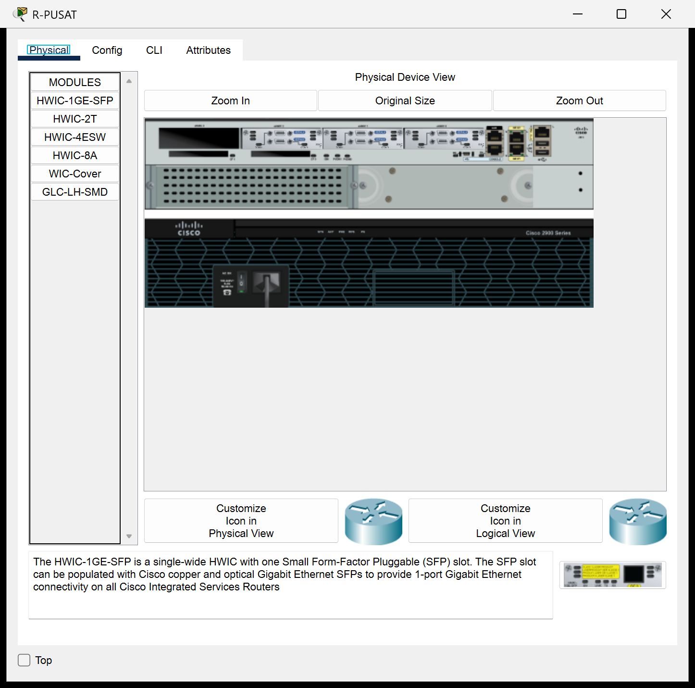](Screenshot/umum/langkah-klik-perangkat.png) *Jendela perangkat terbuka setelah ikon diklik*

### B. Membuka CLI router

Di jendela router, klik tab ① **CLI**. Area ② adalah console IOS.

- Jika muncul `Press RETURN to get started.`, tekan **Enter**.
- Jika router baru ditanya `Would you like to enter the initial configuration dialog? [yes/no]:`, ketik `no` lalu Enter.

[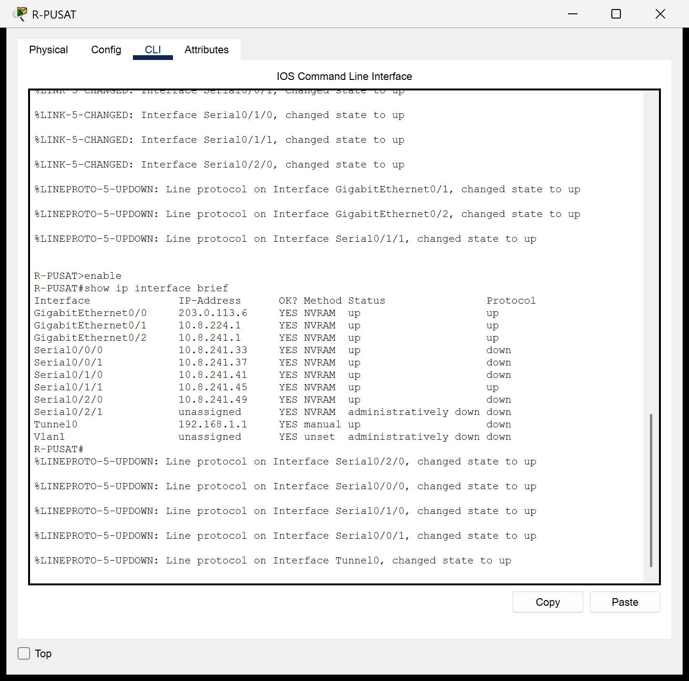](Screenshot/umum/langkah-tab-cli.png) *Tab CLI router (area console ②)*

### C. Mode-mode di CLI

Perintah IOS hanya bisa diketik di mode yang tepat. Prompt menunjukkan mode yang sedang aktif.

| Prompt | Mode | Cara masuk | Dipakai untuk |
| --- | --- | --- | --- |
| `R-PUSAT>` | User EXEC | (awal) | `ping` sederhana |
| `R-PUSAT#` | Privileged EXEC | `enable` | semua perintah `show`, `copy` |
| `R-PUSAT(config)#` | Global config | `configure terminal` | `hostname`, `ip route`, `ip dhcp`, `ip nat`, `access-list` |
| `R-PUSAT(config-if)#` | Interface config | `interface <nama>` | `ip address`, `clock rate`, `no shutdown`, `ip nat inside/outside`, `ip helper-address` |
| `R-PUSAT(dhcp-config)#` | DHCP pool config | `ip dhcp pool <nama>` | `network`, `default-router`, `dns-server` |

`exit` naik satu tingkat, `end` langsung kembali ke `R-PUSAT#`.

### D. Menyimpan konfigurasi router

Setelah selesai mengetik konfigurasi, ketik:

```
end
copy running-config startup-config
```

Saat muncul `Destination filename [startup-config]?`, tekan **Enter**. Konfigurasi tersimpan bila muncul `[OK]`. Tanpa langkah ini, konfigurasi hilang saat router di-*reload*. (`write` memakai pola yang sama.)

[](Screenshot/umum/cli-simpan-konfigurasi.png) *copy running-config startup-config → Building configuration... [OK*

### E. Menyimpan file Packet Tracer

Tekan **Ctrl+S** atau klik ikon **Save** di toolbar. Lakukan setiap selesai satu tahap. Topologi ini disimpan dalam dua file: `K1_VLSM.pkt` (soal 1–6) dan `K1_VLSM_OSPF.pkt` (soal 7).

[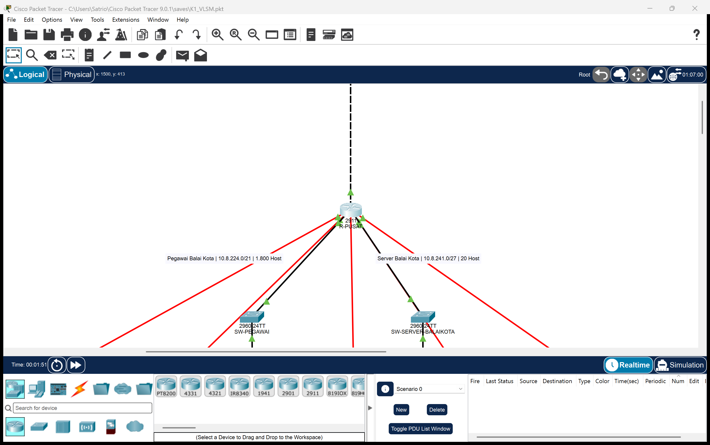](Screenshot/umum/langkah-simpan-file.png) *Toolbar Packet Tracer — ikon Save*

### F. Membuka Command Prompt PC / Server / Smartphone

Klik perangkat → tab ① **Desktop** → ② **Command Prompt**. (③ **IP Configuration** dipakai di soal 4.) Pada smartphone dan server, Command Prompt di antara ikon Desktop lainnya.

[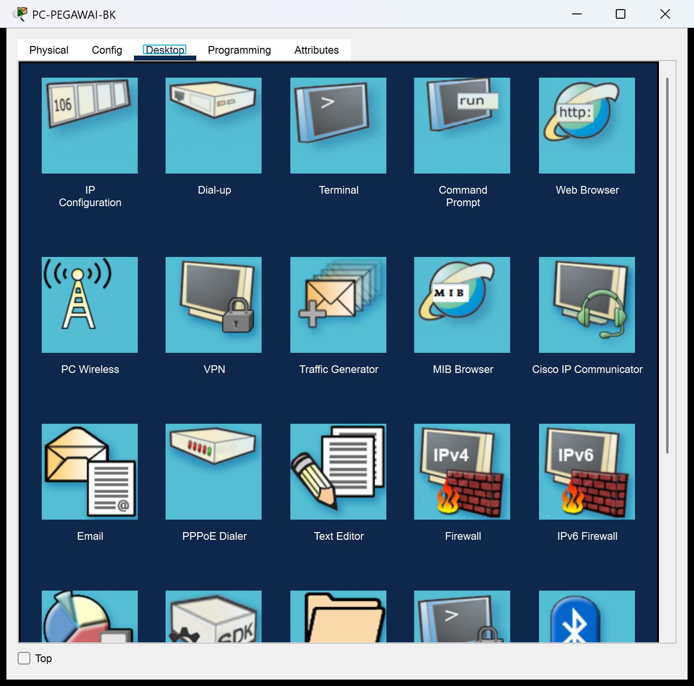](Screenshot/soal-3/langkah-buka-command-prompt.png) *Desktop PC — ikon Command Prompt & IP Configuration*

---

## Soal 1

> Dikerjakan Oleh: **[nama anggota — diisi]**

### Soal

> Bangun topologi di Cisco Packet Tracer sesuai skema yang dipilih (VLSM atau CIDR). Hubungan antar-router (backbone, link L1–L6), termasuk R-ISP dan server 8.8.8.8, wajib mengikuti Gambar 1. Desain setiap lokasi dirancang sendiri (susunan switch, jenis perangkat, media link, penambahan port router) beserta alasannya. Cukup pasang 1 perangkat perwakilan di setiap LAN. Ganti nama bawaan setiap perangkat dan tambahkan label di setiap LAN berisi nama subnet, Network ID/prefix, dan jumlah host.

### Langkah Pengerjaan dan Implementasi

#### Langkah 1 – Memilih perangkat (dan alasannya)

| Bagian | Perangkat | Alasan |
| --- | --- | --- |
| Semua router (8) | **Cisco 2911** + modul **HWIC-2T** | Mengikuti modul praktikum (*06-Tutorial CPT*). Router-PT (IOS 12.2) **tidak punya `interface Tunnel`** dan perintah `crypto` hanya berisi `key`, sehingga GRE (soal 6) dan IPsec (bonus) mustahil. 2911 (IOS 15.1) mendukung GRE bawaan (`ipbasek9`) dan IPsec setelah lisensi `securityk9` aktif. |
| Backbone L1–L6 | Kabel **Serial DCE** | Link antarwilayah kota dimodelkan sebagai link WAN serial seperti di modul. Ujung DCE (pemberi clock) di router atas: R-PUSAT untuk L1–L5, R-UTARA untuk L6. |
| R-PUSAT | 3 × HWIC-2T + 3 port GE bawaan | Butuh 8 interface: 5 serial ke router wilayah (S0/0/0–S0/2/0, S0/2/1 cadangan), G0/0 ke ISP, G0/1 dan G0/2 ke dua LAN Balai Kota. |
| R-UTARA | 2 × HWIC-2T | S0/0/0 untuk L2 ke R-PUSAT dan S0/0/1 untuk L6 ke R-PELABUHAN; slot 0/1 menghasilkan S0/1/0 untuk link cadangan L7 (soal 7). |
| Router wilayah lain | 1 × HWIC-2T | S0/0/0 ke router atas, G0/0 dan G0/1 ke dua LAN. |
| R-ISP | Tanpa modul | Hanya 2 port Gigabit bawaan yang terpakai (G0/0 ke R-PUSAT, G0/1 ke SRV-INTERNET). |
| Link ke ISP & SRV-INTERNET | Copper Cross-Over | Router–router dan router–server adalah perangkat sejenis (kelompok A). |
| Setiap LAN | 1 switch **2960-24TT** | Router → switch lewat port Gigabit (kabel straight). Switch membuat LAN bisa diperluas ke ribuan host sesuai kebutuhan, walau yang dipasang hanya 1 perwakilan. LAN Pegawai Balai Kota dan LAN Server Balai Kota **masing-masing punya switch sendiri** (tanpa VLAN/trunk). |
| WiFi Publik (Barat, Utara, Timur, Selatan) | **AccessPoint-PT** + **Smartphone** (wireless) | Pengguna WiFi publik adalah perangkat bergerak. Tiap AP diberi **SSID sendiri** supaya smartphone tidak tersambung ke AP wilayah lain. |
| CCTV, Sensor Lalin, Sensor Banjir, SCADA, PJU | **PC-PT** (kabel) | Mewakili kamera/sensor/gateway IoT yang dipasang tetap dan butuh koneksi stabil. |
| Pegawai, Puskesmas & Sekolah, Kantor Pelabuhan | **PC-PT** (kabel) | Komputer kerja di gedung. |
| Server Balai Kota, Server & Storage DC, Internet | **Server-PT** (IP statis) | Menjalankan layanan (Web, DNS, DHCP-CCTV, FTP, email). |

#### Langkah 2 – Meletakkan router 2911 dan memasang modul HWIC-2T

1. Klik **Network Devices → Routers → 2911**, seret ke workspace. Ulangi sampai ada 8 router.
2. Klik router → tab **Physical**.
3. ① Klik tombol power sampai lampu hijau padam (modul hanya bisa dipasang saat router mati).
4. ② Klik **HWIC-2T** di daftar MODULES, lalu seret ke slot kosong ③ di panel belakang.
5. Ulangi: **R-PUSAT 3 modul** (slot 0/0, 0/1, 0/2), **R-UTARA 2 modul** (slot 0/0, 0/1), router wilayah 1 modul, R-ISP tidak perlu.
6. Klik tombol power lagi untuk menyalakan router.

[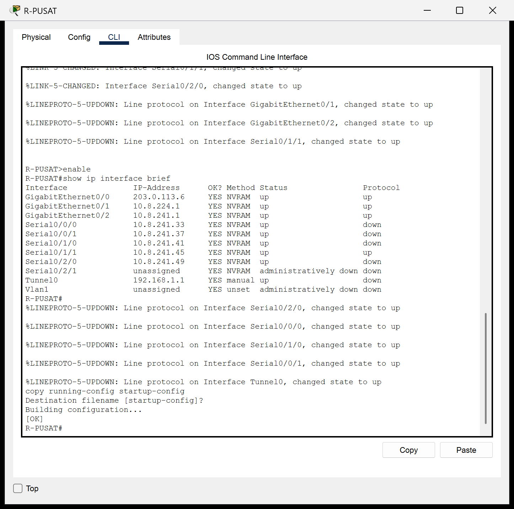](Screenshot/soal-1/langkah-modul-hwic2t.png) *Tab Physical R-PUSAT — modul HWIC-2T terpasang*

#### Langkah 3 – Memasang kabel

1. Klik ① **Connections** (ikon petir) di kiri bawah.
2. Pilih kabel. Nama kabel muncul di bawah daftar saat kursor diarahkan ke ikonnya:
   - ② **Serial DCE** (petir merah berjam) → untuk L1–L6. **Klik router atas dulu** (R-PUSAT, atau R-UTARA untuk L6) agar ujung DCE ada di router atas.
   - **Copper Straight-Through** → router ke switch, switch ke PC/server/AP.
   - **Copper Cross-Over** → R-PUSAT ↔ R-ISP dan R-ISP ↔ SRV-INTERNET.
3. Klik perangkat pertama → pilih port → klik perangkat kedua → pilih port, sesuai [Tabel Port Router](#tabel-port-router).

[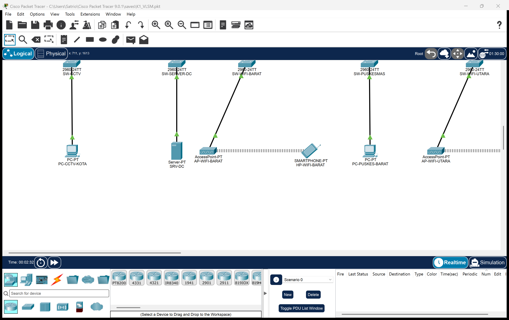](Screenshot/soal-1/langkah-pilih-kabel.png) *Palette Connections + daftar kabel di PT*

#### Langkah 4 – Mengganti nama perangkat

Klik perangkat → tab **Config** → ① **Settings** → ② ketik nama di **Display Name** (router/switch juga di **Hostname**). Nama mengikuti lokasi: `R-PUSAT`, `SW-PEGAWAI-BK`, `PC-CCTV-KOTA`, `SRV-DC`, `AP-WIFI-BARAT`, `HP-WIFI-BARAT`, dst. Tiga *Power Distribution Device* yang dibuat otomatis oleh Packet Tracer 9 (di luar kanvas) diganti menjadi `PDU-1`–`PDU-3`.

[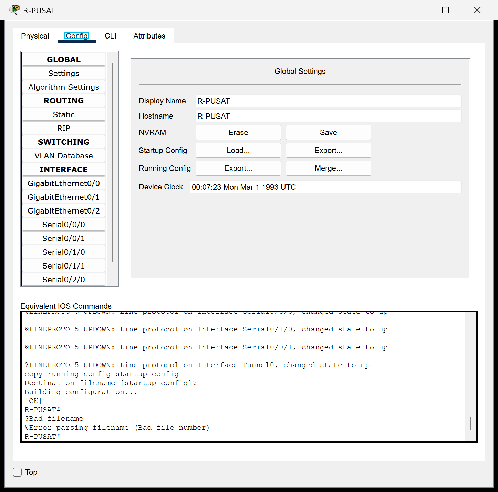](Screenshot/soal-1/langkah-rename-hostname.png) *Jendela Config → Settings — Display Name*

#### Langkah 5 – Konfigurasi IP R-PUSAT lewat CLI

**5.1 Buka CLI R-PUSAT.** Klik ikon **R-PUSAT** → tab **CLI** → tekan Enter (lihat [Panduan A–B](#a-membuka-jendela-perangkat)).

**5.2 Masuk mode konfigurasi dan beri nama router.** Ketik satu per satu:

```
enable
configure terminal
hostname R-PUSAT
no ip domain-lookup
```

| Perintah | Fungsi |
| --- | --- |
| `enable` | masuk mode privileged (`R-PUSAT#`) |
| `configure terminal` | masuk mode konfigurasi global |
| `hostname R-PUSAT` | memberi nama router di CLI |
| `no ip domain-lookup` | mencegah CLI "macet" mencari DNS saat salah ketik (dipasang di **semua** router) |

**5.3 Isi IP ketiga port Gigabit.** Untuk setiap port: masuk interface → beri IP → nyalakan.

```
interface g0/0
ip address 203.0.113.6 255.255.255.252
no shutdown
interface g0/1
ip address 10.8.224.1 255.255.248.0
no shutdown
interface g0/2
ip address 10.8.241.1 255.255.255.224
no shutdown
```

| Perintah | Fungsi |
| --- | --- |
| `interface g0/0` | memilih port GigabitEthernet0/0 (ke R-ISP), prompt menjadi `(config-if)#` |
| `ip address 203.0.113.6 255.255.255.252` | IP publik R-PUSAT di link ISP (host kedua: router bawah) |
| `no shutdown` | menyalakan port (port router mati secara bawaan) |
| `interface g0/1` + IP `10.8.224.1/21` | gateway LAN Pegawai Balai Kota |
| `interface g0/2` + IP `10.8.241.1/27` | gateway LAN Server Balai Kota |

[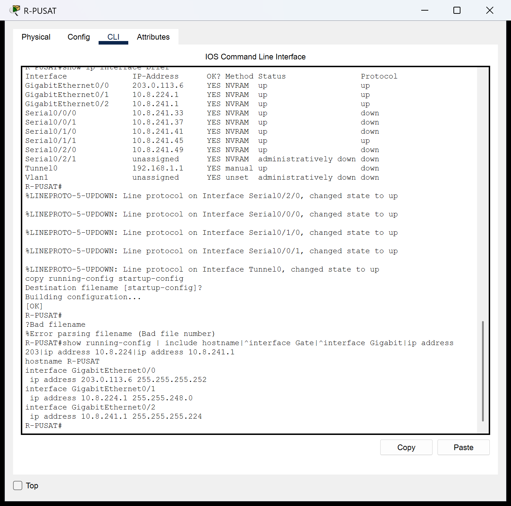](Screenshot/soal-1/cli-pusat-gigabit.png) *R-PUSAT — konfigurasi G0/0–G0/2*

**5.4 Isi IP kelima port serial dan clock rate.** R-PUSAT adalah ujung **DCE**, jadi setiap serial diberi `clock rate 64000`.

```
interface s0/0/0
ip address 10.8.241.33 255.255.255.252
clock rate 64000
no shutdown
```

Ulangi pola yang sama untuk port lain:

| Interface | Link | IP Address |
| --- | --- | --- |
| `s0/0/0` | L1 → R-DC | `10.8.241.33 255.255.255.252` |
| `s0/0/1` | L2 → R-UTARA | `10.8.241.37 255.255.255.252` |
| `s0/1/0` | L3 → R-SELATAN | `10.8.241.41 255.255.255.252` |
| `s0/1/1` | L4 → R-TIMUR | `10.8.241.45 255.255.255.252` |
| `s0/2/0` | L5 → R-BARAT | `10.8.241.49 255.255.255.252` |

[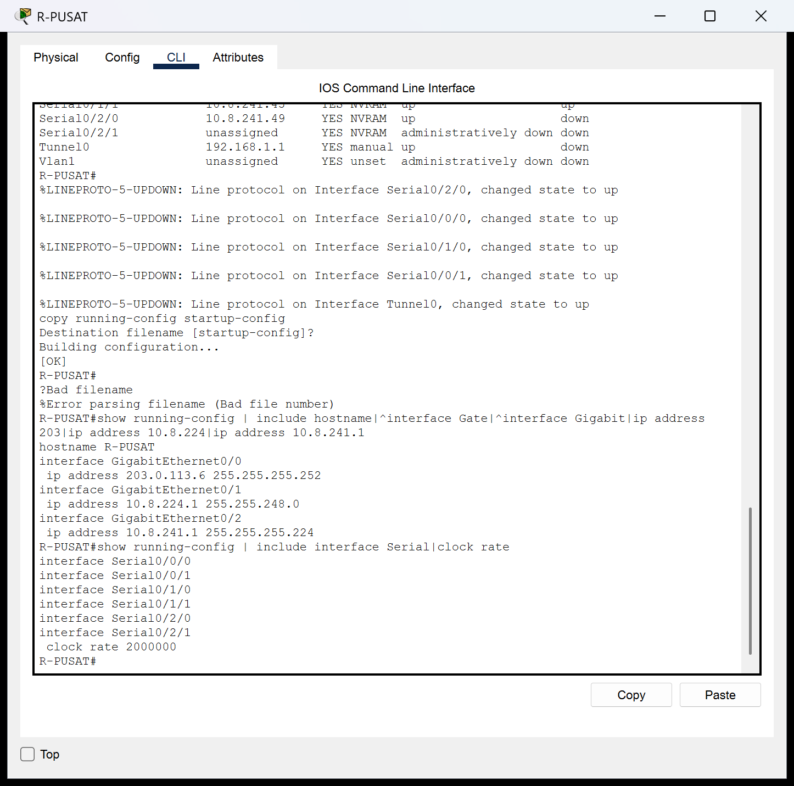](Screenshot/soal-1/cli-pusat-serial-clockrate.png) *R-PUSAT — serial + clock rate 64000*

**5.5 Simpan.** `end` → `copy running-config startup-config` → Enter (lihat [Panduan D](#d-menyimpan-konfigurasi-router)).

> **Alternatif GUI:** tab **Config** → ① pilih interface → ② centang **Port Status On** → ③ **Clock Rate 64000** (hanya DCE) → ④ isi IPv4 Address dan Subnet Mask. Kotak ⑤ menunjukkan perintah IOS setara yang dibuat otomatis. Catatan: mengklik interface di tab Config membuat console masuk mode `(config-if)#`, jadi ketik `end` sebelum memakai perintah `show` di CLI.

#### Langkah 6 – Konfigurasi IP R-UTARA (DCE untuk L6)

R-UTARA adalah DTE di L2 (ke R-PUSAT) tetapi **DCE di L6** (ke R-PELABUHAN), jadi hanya `s0/0/1` yang diberi `clock rate`. Buka CLI R-UTARA, lalu ketik:

```
enable
configure terminal
hostname R-UTARA
no ip domain-lookup
interface g0/0
ip address 10.8.0.1 255.255.192.0
no shutdown
interface g0/1
ip address 10.8.236.1 255.255.254.0
no shutdown
interface s0/0/0
ip address 10.8.241.38 255.255.255.252
no shutdown
interface s0/0/1
ip address 10.8.241.53 255.255.255.252
clock rate 64000
no shutdown
end
copy running-config startup-config
```

[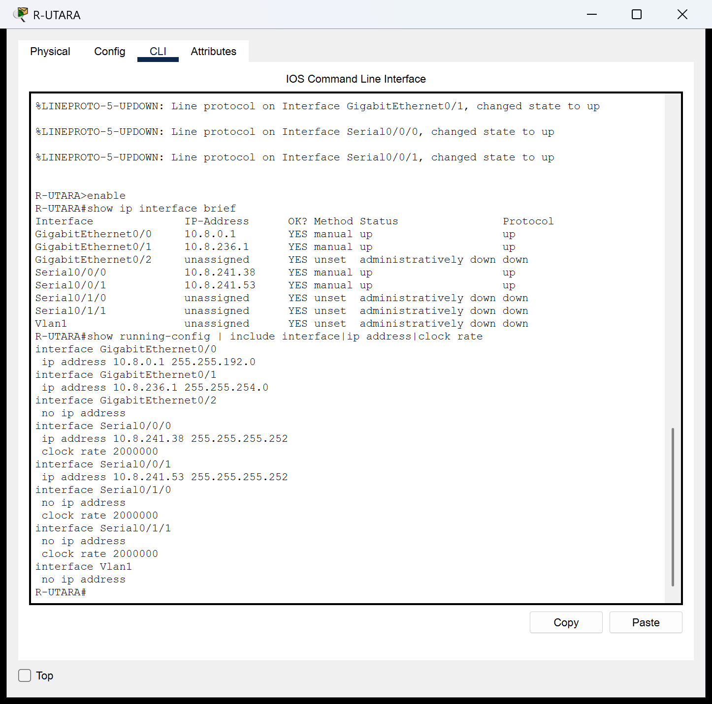](Screenshot/soal-1/cli-utara-interface.png) *R-UTARA — set interface*

#### Langkah 7 – Konfigurasi IP router wilayah (contoh R-DC)

Router wilayah adalah sisi **DTE**, jadi tidak perlu `clock rate`. Buka CLI R-DC, lalu ketik:

```
enable
configure terminal
hostname R-DC
no ip domain-lookup
interface g0/0
ip address 10.8.96.1 255.255.224.0
no shutdown
interface g0/1
ip address 10.8.239.1 255.255.255.0
no shutdown
interface s0/0/0
ip address 10.8.241.34 255.255.255.252
no shutdown
end
copy running-config startup-config
```

[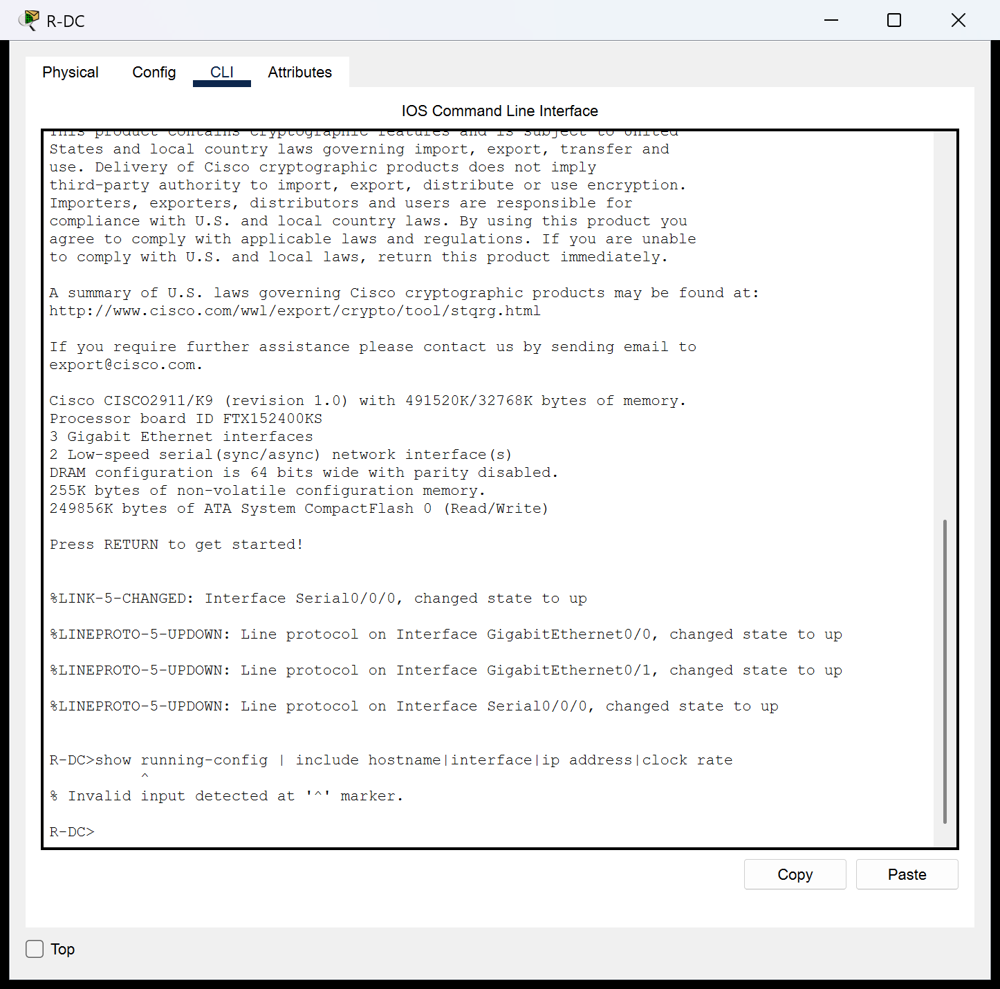](Screenshot/soal-1/cli-dc-interface.png) *R-DC — set interface*

Router wilayah lain memakai pola yang sama dengan nilai berikut:

| Router | `interface g0/0` | `interface g0/1` | `interface s0/0/0` |
| --- | --- | --- | --- |
| R-SELATAN | `10.8.64.1 255.255.224.0` | `10.8.240.129 255.255.255.128` | `10.8.241.42 255.255.255.252` |
| R-TIMUR | `10.8.128.1 255.255.224.0` | `10.8.232.1 255.255.252.0` | `10.8.241.46 255.255.255.252` |
| R-BARAT | `10.8.192.1 255.255.224.0` | `10.8.238.1 255.255.255.0` | `10.8.241.50 255.255.255.252` |
| R-PELABUHAN | `10.8.160.1 255.255.224.0` | `10.8.240.1 255.255.255.128` | `10.8.241.54 255.255.255.252` |

#### Langkah 8 – Konfigurasi IP R-ISP dan SRV-INTERNET

R-ISP (CLI):

```
enable
configure terminal
hostname R-ISP
no ip domain-lookup
interface g0/0
ip address 203.0.113.5 255.255.255.252
no shutdown
interface g0/1
ip address 8.8.8.1 255.255.255.0
no shutdown
end
copy running-config startup-config
```

SRV-INTERNET (GUI): Desktop → IP Configuration → Static → IP `8.8.8.8`, mask `255.255.255.0`, gateway `8.8.8.1`.

#### Langkah 9 – IP statis server internal

Desktop → IP Configuration → Static:

| Server | IP | Mask | Gateway | DNS |
| --- | --- | --- | --- | --- |
| SRV-DC | `10.8.239.2` | `255.255.255.0` | `10.8.239.1` | `10.8.239.2` |
| SRV-BALAIKOTA | `10.8.241.2` | `255.255.255.224` | `10.8.241.1` | `10.8.239.2` |

#### Langkah 10 – SSID per Access Point

1. Klik AP → tab **Config** → ① **Port 1** → ② ganti **SSID** (misalnya `WIFI-BARAT`), tekan Enter. ③ Authentication dibiarkan *Disabled* (WiFi publik).

   [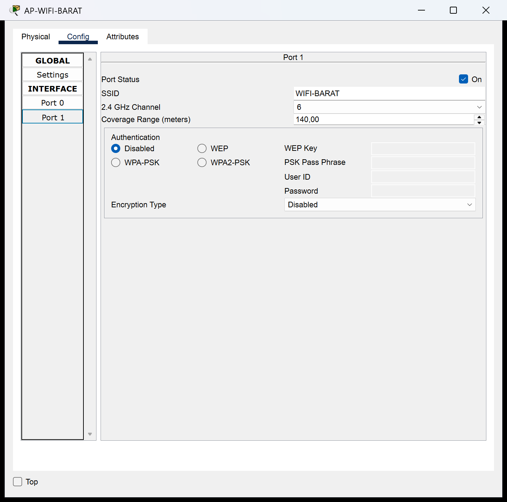](Screenshot/soal-1/langkah-ssid-ap.png) *AP Config → Port 1 — SSID WIFI-BARAT*

2. Klik smartphone wilayah yang sama → tab **Config** → ① **Wireless0** → ② isi SSID yang sama. ③ IP Configuration tetap **DHCP**; setelah tersambung ke AP yang benar, smartphone langsung mendapat IP dari subnet wilayahnya.

   [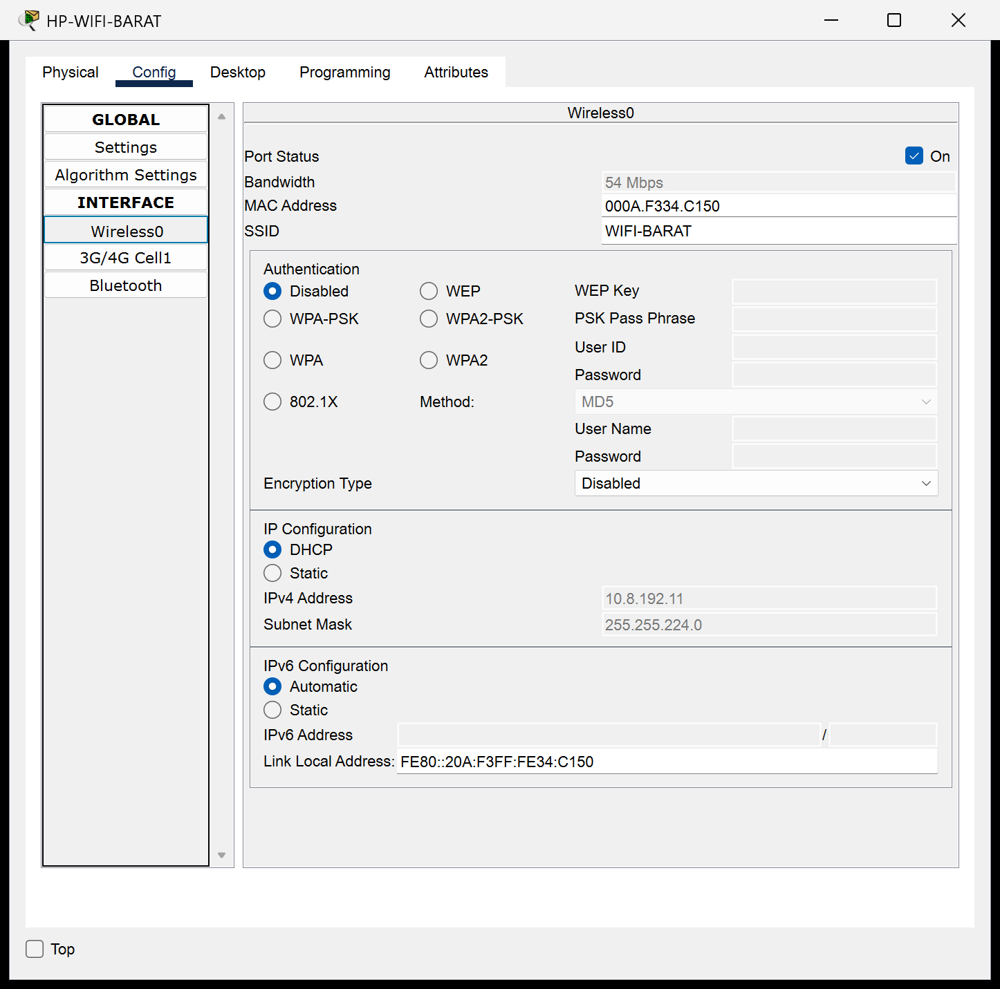](Screenshot/soal-1/langkah-ssid-hp.png) *HP Config → Wireless0 — SSID WIFI-BARAT*

| Access Point | Smartphone | SSID |
| --- | --- | --- |
| AP-WIFI-BARAT | HP-WIFI-BARAT | `WIFI-BARAT` |
| AP-WIFI-UTARA | HP-WIFI-UTARA | `WIFI-UTARA` |
| AP-WIFI-TIMUR | HP-WIFI-TIMUR | `WIFI-TIMUR` |
| AP-WIFI-SELATAN | HP-WIFI-SELATAN | `WIFI-SELATAN` |

#### Langkah 11 – Label topologi

Klik ① **Place Note** (atau tekan **N**) di toolbar, klik area kanvas, lalu tulis nama subnet, network ID/prefix, dan jumlah host **sesuai soal** (bukan ukuran blok), contoh: `WiFi Publik Utara | 10.8.0.0/18 | 11.000 Host`. Total 14 label LAN + judul **"Gambar 1"** di atas kanvas.

[](Screenshot/soal-1/langkah-place-note-label.png) *Kanvas dengan 14 label subnet (Place Note)*

### Bukti dan Hasil

1. **Topologi lengkap**: lihat [gambar di bagian Ringkasan](#ringkasan-topologi--tabel-pengalamatan-ip). Backbone sama dengan Gambar 1 soal, semua perangkat sudah diganti namanya, dan setiap LAN berlabel.

2. **Semua interface R-PUSAT aktif**
   - **Node**: `R-PUSAT` → tab CLI → `show ip interface brief`

   [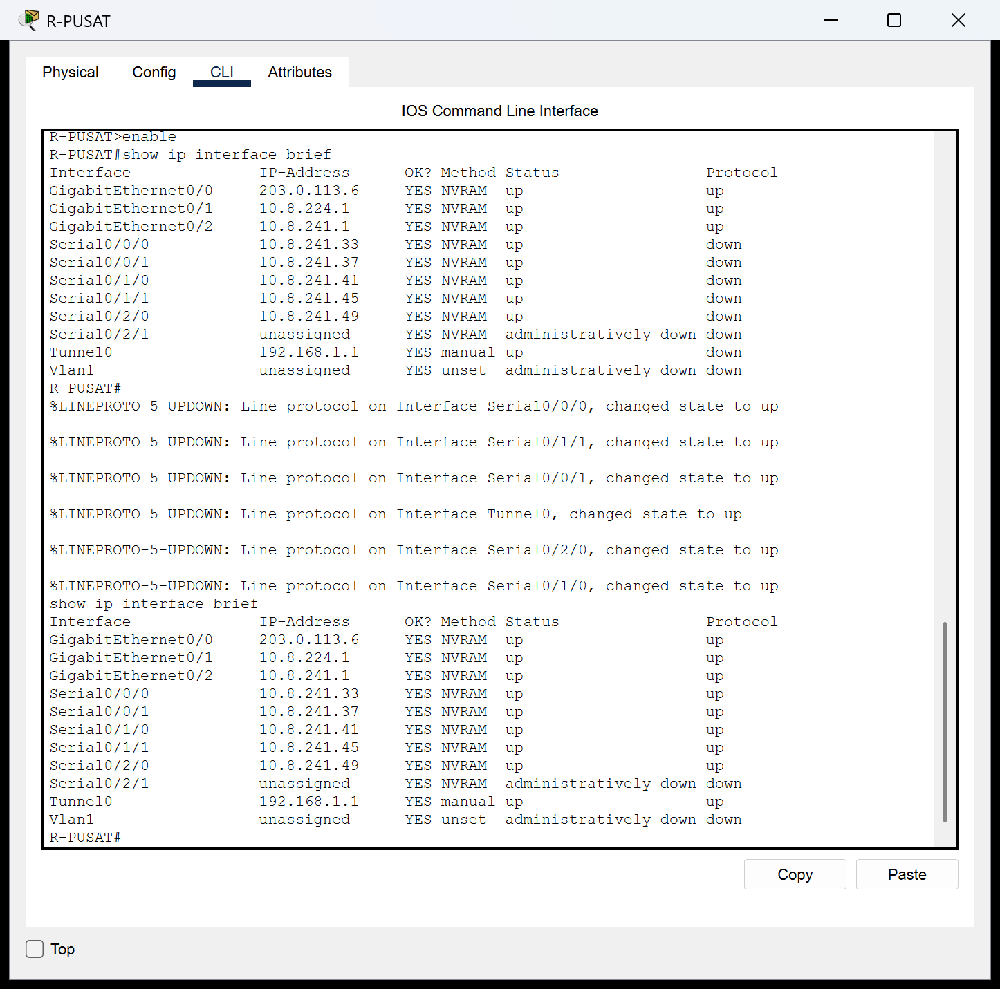](Screenshot/soal-1/bukti-ip-int-brief-pusat.png) *show ip interface brief R-PUSAT*

3. **Kabel tersambung ke port yang benar**
   - **Node**: `R-PUSAT` → `show cdp neighbors`

   [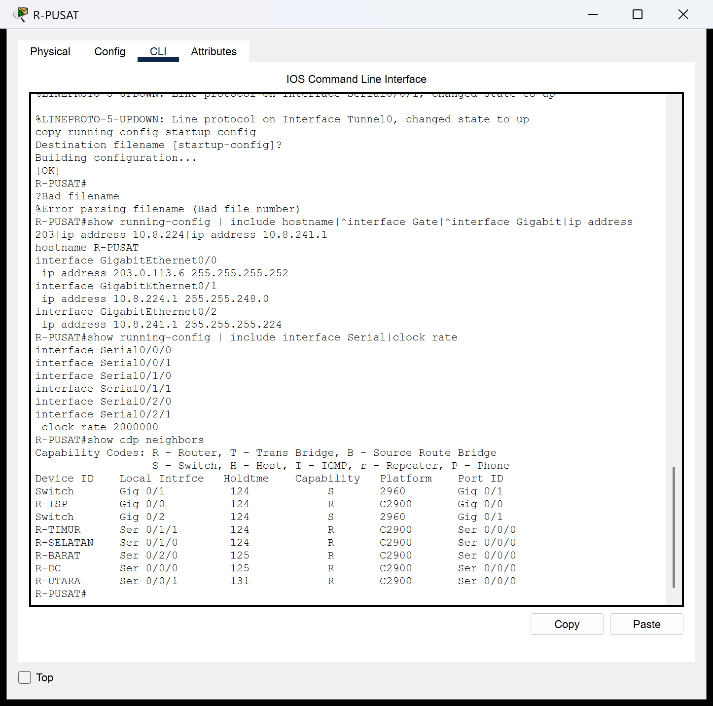](Screenshot/soal-1/bukti-cdp-neighbors-pusat.png) *show cdp neighbors R-PUSAT*

4. **Sisi DCE dan clock rate benar** (`show controllers serial0/0/0`, `show controllers serial0/0/1`):

```
R-PUSAT  Serial0/0/0 : DCE V.35, clock rate 64000
R-UTARA  Serial0/0/1 : DCE V.35, clock rate 64000
R-DC     Serial0/0/0 : DTE V.35 TX and RX clocks detected
```

[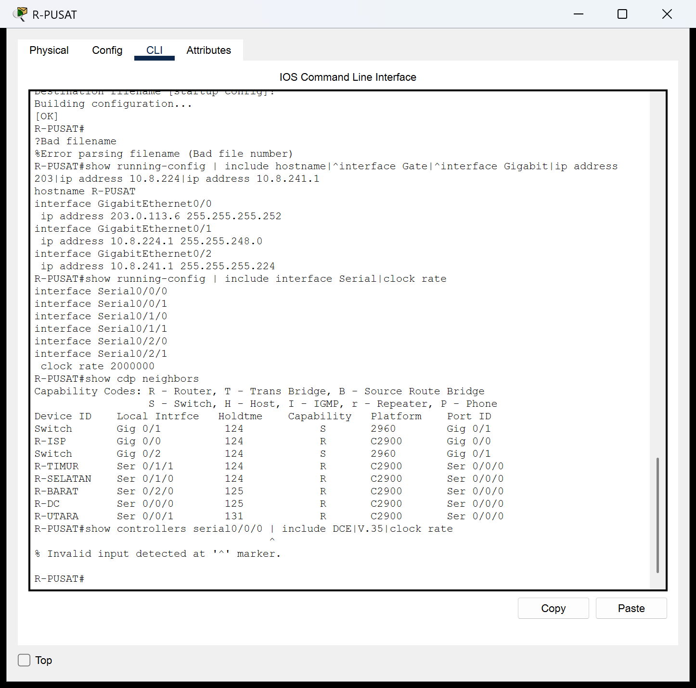](Screenshot/soal-1/bukti-controllers-dce.png) *show controllers s0/0/0 — DCE, clock rate 64000*

5. **4 smartphone mendapat IP sesuai subnet wilayahnya** (Desktop → IP Configuration):

| Smartphone | IP dapat | Gateway |
| --- | --- | --- |
| HP-WIFI-BARAT | `10.8.192.18` | `10.8.192.1` |
| HP-WIFI-UTARA | `10.8.0.12` | `10.8.0.1` |
| HP-WIFI-TIMUR | `10.8.128.14` | `10.8.128.1` |
| HP-WIFI-SELATAN | `10.8.64.15` | `10.8.64.1` |

[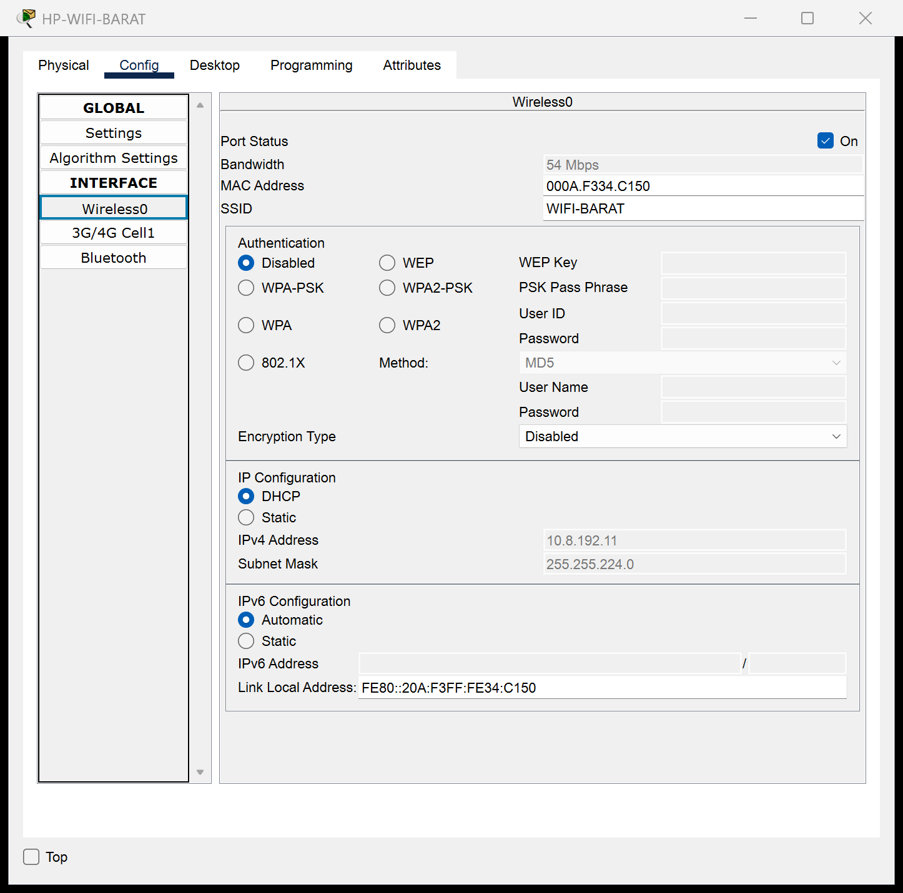](Screenshot/soal-1/bukti-hp-lease-dhcp.png) *HP-WIFI-BARAT lease DHCP 10.8.192.11 + SSID*

---

## Soal 2

> Dikerjakan Oleh: **[nama anggota — diisi]**

### Soal

> Menggunakan VLSM dan CIDR, buat tabel di spreadsheet berisi nama subnet, network ID, prefix, rentang host, alamat broadcast, dan gateway untuk setiap subnet sesuai lembar jawaban UTS. Perbaikan dari UTS wajib dicatat di tabel revisi.

### Langkah Pengerjaan dan Implementasi

Perhitungan lengkap ada di spreadsheet **`Tabel_Subnetting_VLSM_CIDR_K1.xlsx`** di dalam repo ini:

| Sheet | Isi |
| --- | --- |
| `1_Tabel_VLSM` | 14 LAN: jumlah host soal, kebutuhan (+2), ukuran blok, prefix, subnet mask, network ID, gateway, rentang host, broadcast — diurutkan dari kebutuhan terbesar |
| `2_Tabel_CIDR_Supernet` | Supernet per router (cabang Utara `10.8.0.0/17`, cabang Selain Utara `10.8.128.0/17` dan `10.9.0.0/17`) sesuai pohon UTS soal 4b |
| `3_Efisiensi_dan_Revisi` | Perbandingan efisiensi VLSM vs CIDR (94,20% vs 47,10%) **+ Tabel Revisi 11 baris** dari kertas folio UTS |

### Bukti dan Hasil

1. **Tabel VLSM final**: lihat [Tabel VLSM di Ringkasan](#tabel-vlsm) — identik dengan sheet `1_Tabel_VLSM`.
2. **Tabel revisi 11 baris** (wajib, sesuai soal 2 poin ke-2) berisi koreksi utama dari kertas UTS:

| No | Bagian | Jawaban UTS | Perbaikan |
| --- | --- | --- | --- |
| 1 | Blok IP Dasar (1a) | `192.8.0.0/16` | `10.8.0.0/16` (IP private Kelas A, oktet ke-2 = 8 × K = 8) |
| 2 | Kebutuhan R-Barat (1b) | `8192 − 256 + 2 = 7938` | `8192 + 256 + 4 = 8452` → `/18` |
| 3–9 | Rentang/BC subnet WiFi Barat s/d Server Balai Kota | oktet ke-3 meleset hingga 5 blok | dikoreksi mengikuti penjumlahan blok yang benar (`/19` +32 blok → `.223`, dst.) |
| 10 | Link backbone L1–L6 `/30` | belum dimasukkan | `10.8.241.32/30` s/d `10.8.241.52/30` |
| 11 | Soal 4b & 5 (CIDR/efisiensi) | CIDR dianggap lebih efisien | **VLSM lebih efisien** (94,20% vs 47,10%) |

Rincian lengkap 11 baris tersedia di sheet `3_Efisiensi_dan_Revisi`.

---

## Soal 3

> Dikerjakan Oleh: **[nama anggota — diisi]**

### Soal

> Seluruh LAN dapat saling berkomunikasi hanya dengan static route (dan default route untuk arah keluar). Default route hanya boleh mengarah ke router di atasnya / keluar. R-PUSAT wajib punya static route ke semua LAN milik R-DC, R-UTARA, R-PELABUHAN, R-SELATAN, R-TIMUR, dan R-BARAT. R-UTARA wajib punya static route ke semua LAN milik R-PELABUHAN.

### Langkah Pengerjaan dan Implementasi

#### Konsep

- **Router wilayah (R-DC, R-BARAT, R-TIMUR, R-SELATAN) dan R-PELABUHAN adalah *stub***: hanya punya satu jalan keluar, yaitu router di atasnya. Semua tujuan selain LAN-nya sendiri cukup dikirim lewat **satu default route** ke atas.
- **R-UTARA** punya dua arah: ke atas (R-PUSAT) dan ke bawah (R-PELABUHAN). Default route ke atas, ditambah **2 static route** ke LAN Pelabuhan lewat L6.
- **R-PUSAT** adalah persimpangan. Default route-nya sudah dipakai ke ISP, jadi untuk LAN di bawahnya harus ada **static route spesifik** (+1 rute ke link L6). Tanpa rute spesifik, paket ke LAN wilayah ikut default route ke ISP lalu dibuang. Karena *longest prefix match*, rute `/19`, `/24`, dst. selalu menang atas default `/0`.
- **Rute ke LAN Pelabuhan dari R-PUSAT dibuat lewat Tunnel GRE** (`via 192.168.1.2`, soal 6) sesuai ketentuan "lalu lintas Balai Kota ↔ Pelabuhan wajib lewat tunnel". Rute ke link **L6 `10.8.241.52/30`** tetap diperlukan agar alamat fisik R-PELABUHAN (`10.8.241.54`) bisa dicapai — alamat ini menjadi *tunnel destination*.
- **Next hop selalu IP router seberang** di link yang bersangkutan.
- **R-ISP sengaja tidak diberi rute** ke `10.8.0.0` (syarat soal 5).

Format perintah: `ip route <network tujuan> <subnet mask> <next hop>`

#### Langkah 1 – Static route di R-PUSAT

1. Buka CLI **R-PUSAT**, lalu masuk mode konfigurasi: `enable` → `configure terminal`.

2. Ketik static route ke bawah, satu baris per jaringan tujuan:

| Perintah | Tujuan | Lewat |
| --- | --- | --- |
| `ip route 10.8.96.0 255.255.224.0 10.8.241.34` | LAN CCTV Kota | R-DC (L1) |
| `ip route 10.8.239.0 255.255.255.0 10.8.241.34` | LAN Server & Storage DC | R-DC (L1) |
| `ip route 10.8.0.0 255.255.192.0 10.8.241.38` | LAN WiFi Utara | R-UTARA (L2) |
| `ip route 10.8.236.0 255.255.254.0 10.8.241.38` | LAN Sensor Lalin | R-UTARA (L2) |
| `ip route 10.8.241.52 255.255.255.252 10.8.241.38` | link L6 | R-UTARA (L2) |
| `ip route 10.8.64.0 255.255.224.0 10.8.241.42` | LAN WiFi Selatan | R-SELATAN (L3) |
| `ip route 10.8.240.128 255.255.255.128 10.8.241.42` | LAN PJU Pintar | R-SELATAN (L3) |
| `ip route 10.8.128.0 255.255.224.0 10.8.241.46` | LAN WiFi Timur | R-TIMUR (L4) |
| `ip route 10.8.232.0 255.255.252.0 10.8.241.46` | LAN Sensor Banjir | R-TIMUR (L4) |
| `ip route 10.8.192.0 255.255.224.0 10.8.241.50` | LAN WiFi Barat | R-BARAT (L5) |
| `ip route 10.8.238.0 255.255.255.0 10.8.241.50` | LAN Puskesmas & Sekolah | R-BARAT (L5) |
| `ip route 10.8.160.0 255.255.224.0 192.168.1.2` | LAN SCADA Pelabuhan | **Tunnel GRE** (soal 6) |
| `ip route 10.8.240.0 255.255.255.128 192.168.1.2` | LAN Kantor Pelabuhan | **Tunnel GRE** (soal 6) |

3. Ketik default route ke internet:

```
ip route 0.0.0.0 0.0.0.0 203.0.113.5
```

4. Simpan: `end` → `copy running-config startup-config` → Enter.

[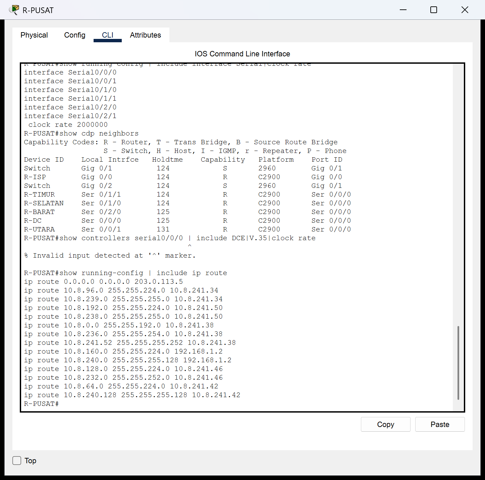](Screenshot/soal-3/cli-pusat-static-route.png) *show run | include ip route (R-PUSAT)*

#### Langkah 2 – Static route di R-UTARA

Buka CLI **R-UTARA** → `enable` → `configure terminal`, lalu ketik:

```
ip route 0.0.0.0 0.0.0.0 10.8.241.37
ip route 10.8.160.0 255.255.224.0 10.8.241.54
ip route 10.8.240.0 255.255.255.128 10.8.241.54
```

| Perintah | Fungsi |
| --- | --- |
| `ip route 0.0.0.0 0.0.0.0 10.8.241.37` | default route ke atas (R-PUSAT) |
| `ip route 10.8.160.0 255.255.224.0 10.8.241.54` | LAN SCADA lewat R-PELABUHAN |
| `ip route 10.8.240.0 255.255.255.128 10.8.241.54` | LAN Kantor Pelabuhan lewat R-PELABUHAN |

[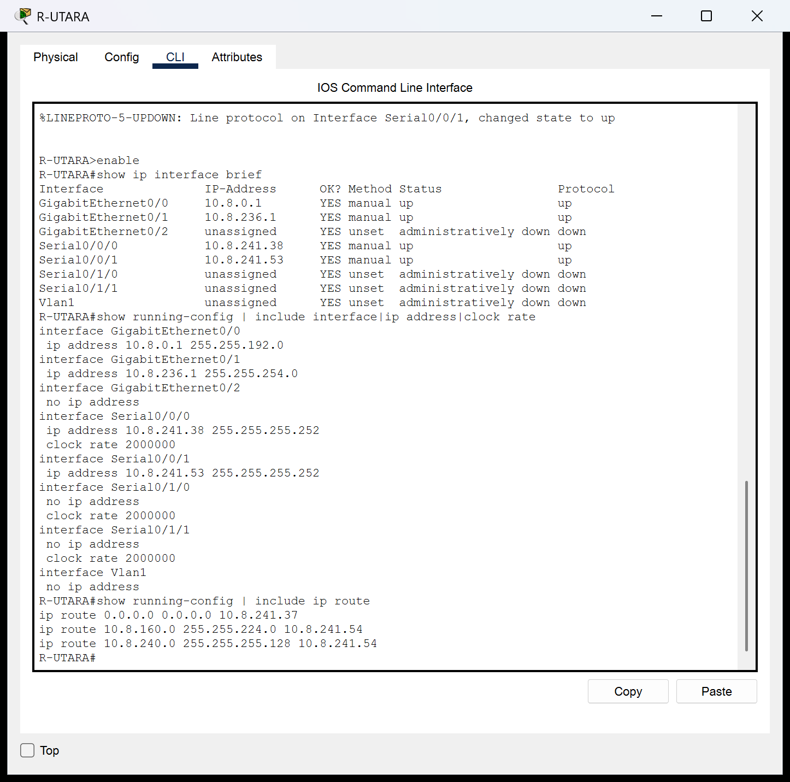](Screenshot/soal-3/cli-utara-static-route.png) *show run | include ip route (R-UTARA)*

Simpan: `end` → `copy running-config startup-config`.

#### Langkah 3 – Static route di R-PELABUHAN (arah balik lewat tunnel)

```
ip route 0.0.0.0 0.0.0.0 10.8.241.53
ip route 10.8.224.0 255.255.248.0 192.168.1.1
ip route 10.8.241.0 255.255.255.224 192.168.1.1
```

| Perintah | Fungsi |
| --- | --- |
| `ip route 0.0.0.0 0.0.0.0 10.8.241.53` | default route ke atas (R-UTARA) |
| `ip route 10.8.224.0 255.255.248.0 192.168.1.1` | LAN Pegawai Balai Kota **via Tunnel** |
| `ip route 10.8.241.0 255.255.255.224 192.168.1.1` | LAN Server Balai Kota **via Tunnel** |

Simpan.

#### Langkah 4 – Default route di router stub (contoh R-DC)

Buka CLI **R-DC** → `enable` → `configure terminal`, lalu ketik:

```
ip route 0.0.0.0 0.0.0.0 10.8.241.33
```

[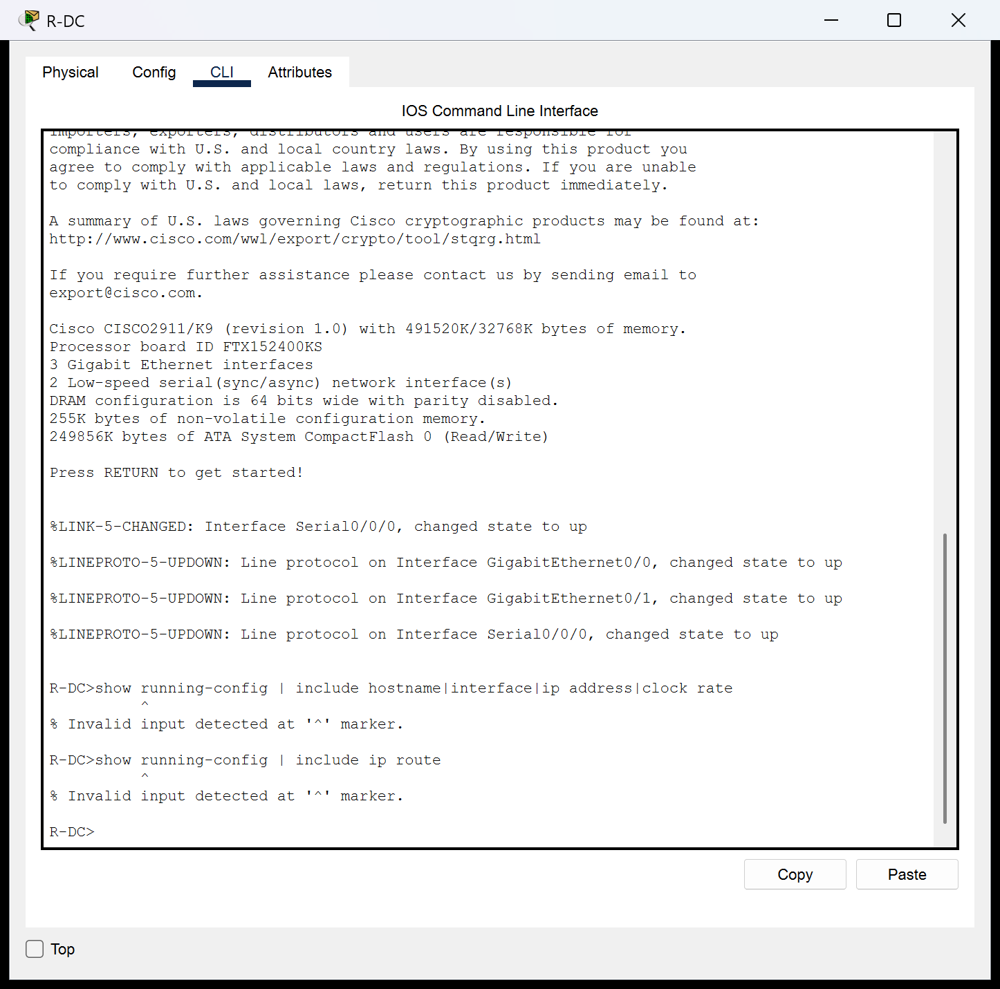](Screenshot/soal-3/cli-dc-default-route.png) *show run | include ip route (R-DC)*

Router stub lainnya:

| Router | Perintah |
| --- | --- |
| R-SELATAN | `ip route 0.0.0.0 0.0.0.0 10.8.241.41` |
| R-TIMUR | `ip route 0.0.0.0 0.0.0.0 10.8.241.45` |
| R-BARAT | `ip route 0.0.0.0 0.0.0.0 10.8.241.49` |

Simpan setiap router: `end` → `copy running-config startup-config`.

### Bukti dan Hasil

#### Tabel routing

1. **R-PUSAT** – `show ip route | include S`

   [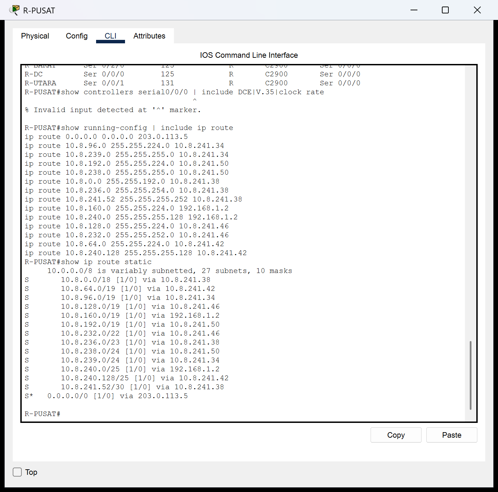](Screenshot/soal-3/bukti-route-static-pusat.png) *show ip route static R-PUSAT*

2. **R-UTARA** – `show ip route static`

   [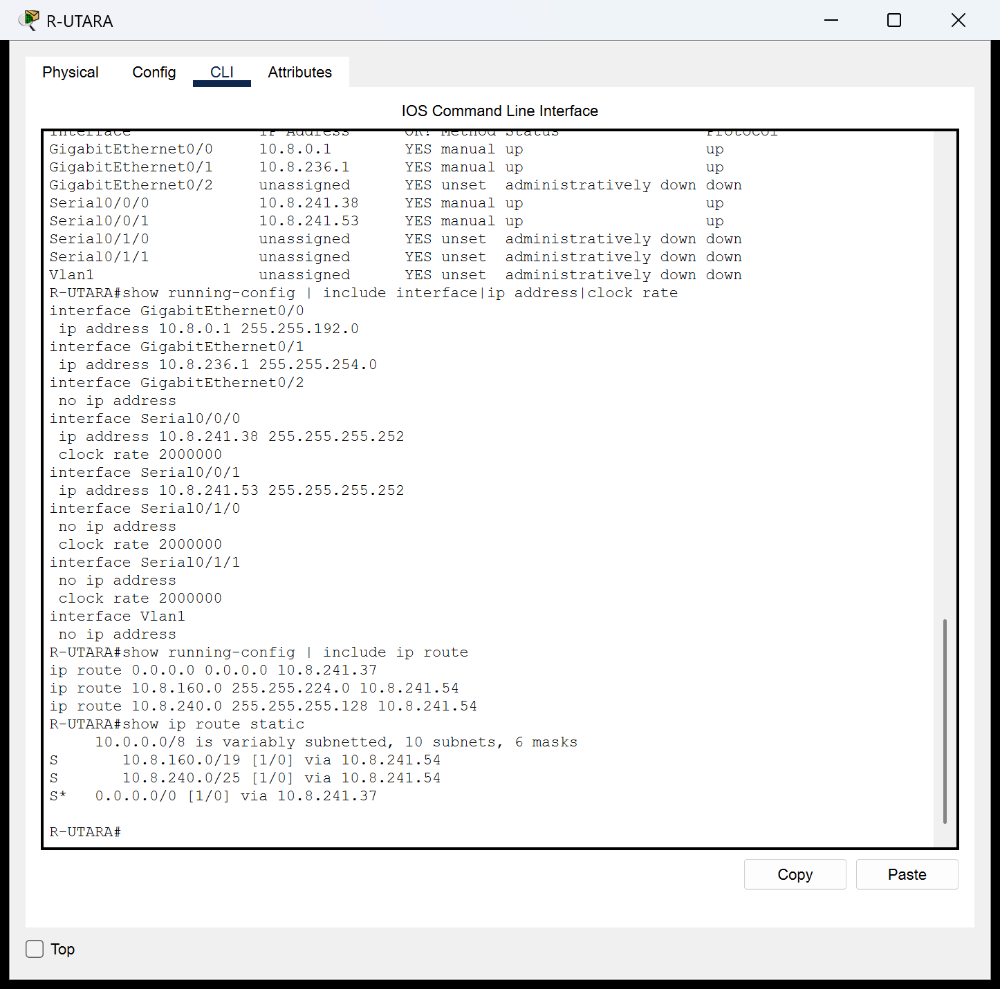](Screenshot/soal-3/bukti-route-static-utara.png) *show ip route static R-UTARA*

3. **R-DC (router stub)** – `show ip route`

   [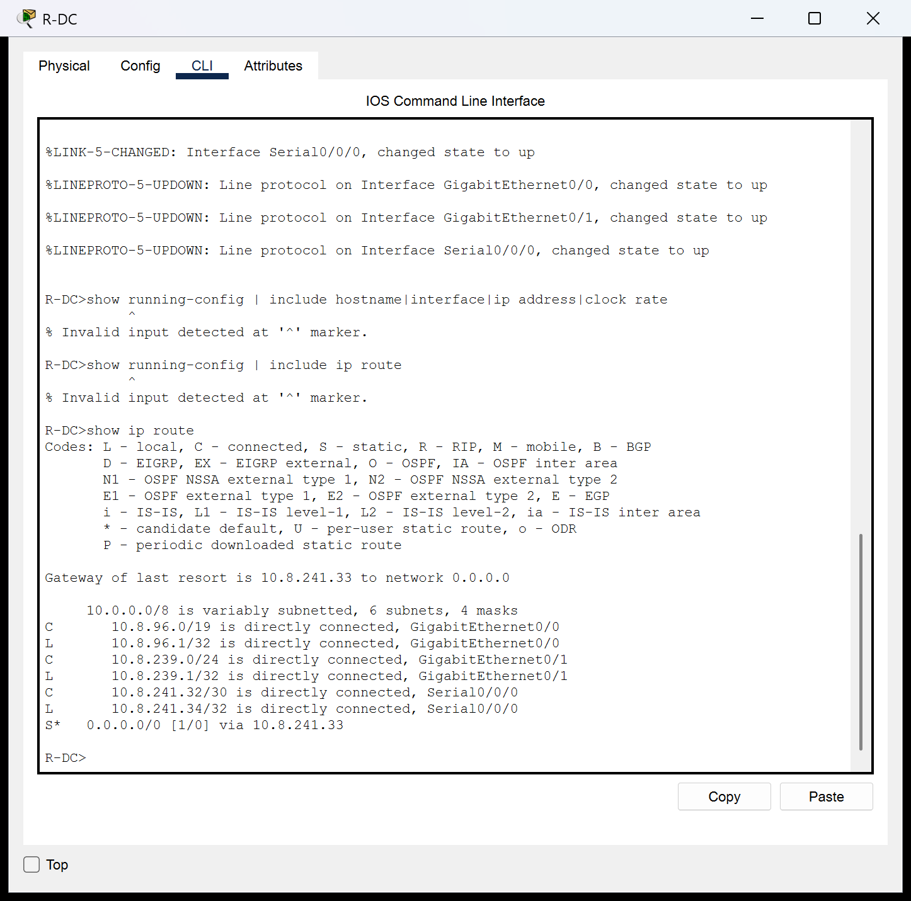](Screenshot/soal-3/bukti-route-dc.png) *show ip route R-DC (stub)*

#### Uji koneksi (Command Prompt, lihat [Panduan F](#f-membuka-command-prompt-pc--server--smartphone))

Pada setiap gambar: ① balasan `Reply from ...`, ② statistik `0% loss`.

| No | Dari | Ke | Jalur | Hasil |
| --- | --- | --- | --- | --- |
| 1 | PC-CCTV-KOTA | Gateway sendiri `10.8.96.1` | dalam LAN | ✅ |
| 2 | PC-CCTV-KOTA | PC-KANTOR-PB `10.8.240.11` | R-DC → R-PUSAT → (L2 → L6) atau Tunnel GRE | ✅ |
| 3 | PC-KANTOR-PB | PC-PEGAWAI `10.8.224.11` | R-PELABUHAN → Tunnel GRE → R-PUSAT | ✅ |
| 4 | PC-KANTOR-PB | SRV-DC `10.8.239.2` | R-PELABUHAN → R-UTARA → R-PUSAT → R-DC | ✅ |
| 5 | PC-PJU | PC-LALIN `10.8.236.11` | R-SELATAN → R-PUSAT → R-UTARA | ✅ |
| 6 | HP-WIFI-BARAT (wireless) | SRV-BALAIKOTA `10.8.241.2` | AP → R-BARAT → R-PUSAT | ✅ |

[](Screenshot/soal-3/ping-antar-lan-3.png) *① ping Balai Kota–Pelabuhan lewat tunnel, ② Reply + 0% loss.*

**Rekap uji ping ke seluruh gateway LAN** (ping 4 paket dari kedua ujung jaringan):

| Dari | Ke 14 gateway LAN | Hasil |
| --- | --- | --- |
| PC-CCTV-KOTA (sisi R-DC) | `10.8.0.1`, `10.8.64.1`, `10.8.96.1`, `10.8.128.1`, `10.8.160.1`, `10.8.192.1`, `10.8.224.1`, `10.8.232.1`, `10.8.236.1`, `10.8.238.1`, `10.8.239.1`, `10.8.240.1`, `10.8.240.129`, `10.8.241.1` | **14/14** ✅ |
| PC-KANTOR-PB (sisi R-PELABUHAN) | 14 gateway yang sama | **14/14** ✅ |

*Ping pertama kadang kehilangan 1 paket karena ARP; ulangi sekali bila muncul `Request timed out` di paket pertama.*

---

## Soal 4

> Dikerjakan Oleh: **[nama anggota — diisi]**

### Soal

> Interface router dan seluruh server menggunakan IP statis. Perangkat pengguna mendapat IP dinamis secara otomatis, lengkap dengan gateway dan DNS server, tanpa bentrok dengan alamat IP statis. Khusus subnet CCTV Kota (subnet R-DC) mendapatkan alamat dari server DHCP di LAN Server dan Storage DC, bukan dari router.

### Langkah Pengerjaan dan Implementasi

#### Langkah 1 – IP statis server

Sudah dikerjakan di [Soal 1 Langkah 9](#langkah-9--ip-statis-server-internal): SRV-DC `10.8.239.2/24`, SRV-BALAIKOTA `10.8.241.2/27`, SRV-INTERNET `8.8.8.8/24`.

#### Langkah 2 – DHCP pool di R-PUSAT (LAN Pegawai)

1. Buka CLI **R-PUSAT** → `enable` → `configure terminal`.

2. Kecualikan alamat statis agar tidak dibagikan DHCP:

```
ip dhcp excluded-address 10.8.224.1 10.8.224.10
```

3. Buat pool, lalu isi jaringan, gateway, dan DNS-nya:

```
ip dhcp pool PEGAWAI
network 10.8.224.0 255.255.248.0
default-router 10.8.224.1
dns-server 10.8.239.2
exit
```

4. Simpan: `end` → `copy running-config startup-config`.

| Perintah | Fungsi | Prompt setelahnya |
| --- | --- | --- |
| `ip dhcp excluded-address 10.8.224.1 10.8.224.10` | `.1`–`.10` tidak pernah dibagikan (gateway, server, cadangan) | `(config)#` |
| `ip dhcp pool PEGAWAI` | membuat pool bernama PEGAWAI | `(dhcp-config)#` |
| `network 10.8.224.0 255.255.248.0` | jaringan yang dilayani pool ini | `(dhcp-config)#` |
| `default-router 10.8.224.1` | gateway yang diberikan ke klien | `(dhcp-config)#` |
| `dns-server 10.8.239.2` | DNS yang diberikan ke klien (SRV-DC) | `(dhcp-config)#` |
| `exit` | keluar dari pool | `(config)#` |

[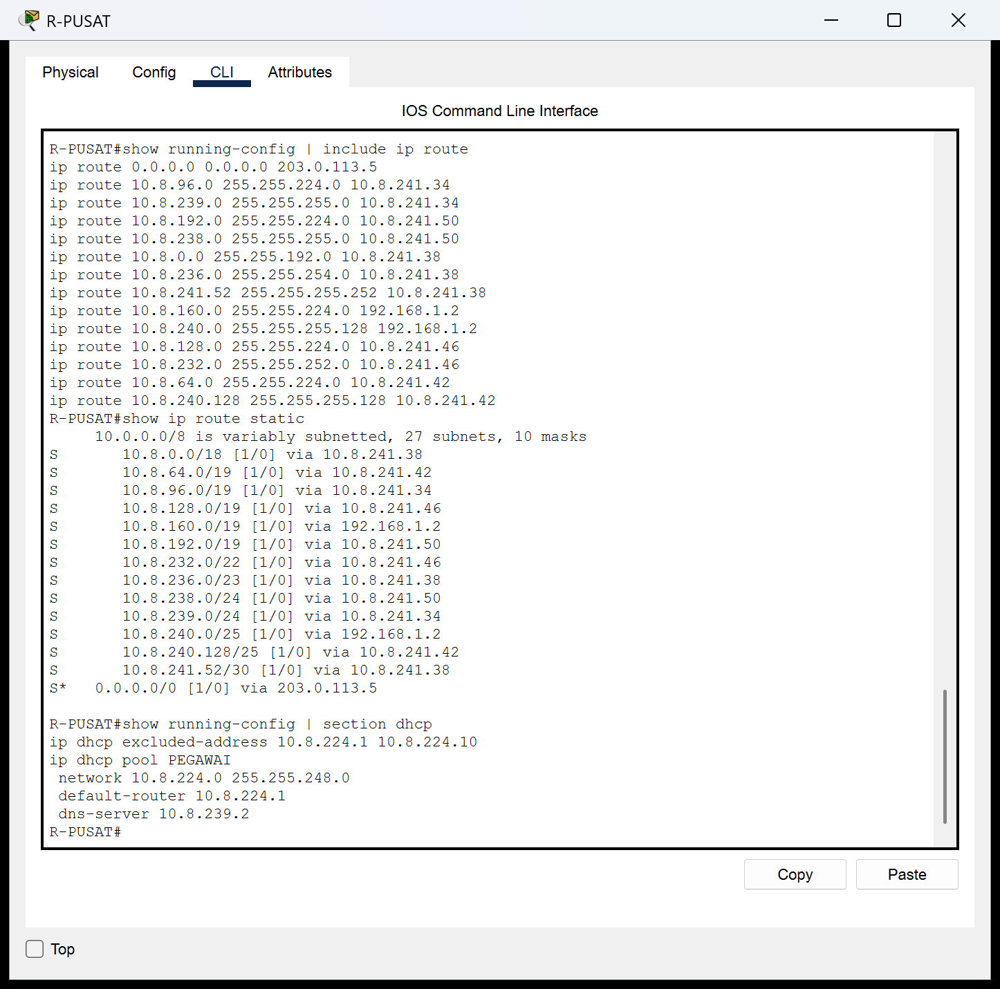](Screenshot/soal-4/cli-pusat-dhcp-pool.png) *show run | section dhcp (R-PUSAT)*

#### Langkah 3 – DHCP pool di router wilayah (contoh R-UTARA, 2 pool)

Router dengan dua LAN pengguna membuat dua pool. Buka CLI **R-UTARA** → `enable` → `configure terminal`, lalu ketik:

```
ip dhcp excluded-address 10.8.0.1 10.8.0.10
ip dhcp pool WIFI-PUB-UTARA
network 10.8.0.0 255.255.192.0
default-router 10.8.0.1
dns-server 10.8.239.2
exit
ip dhcp excluded-address 10.8.236.1 10.8.236.10
ip dhcp pool SENSOR-LALIN-UTARA
network 10.8.236.0 255.255.254.0
default-router 10.8.236.1
dns-server 10.8.239.2
exit
```

[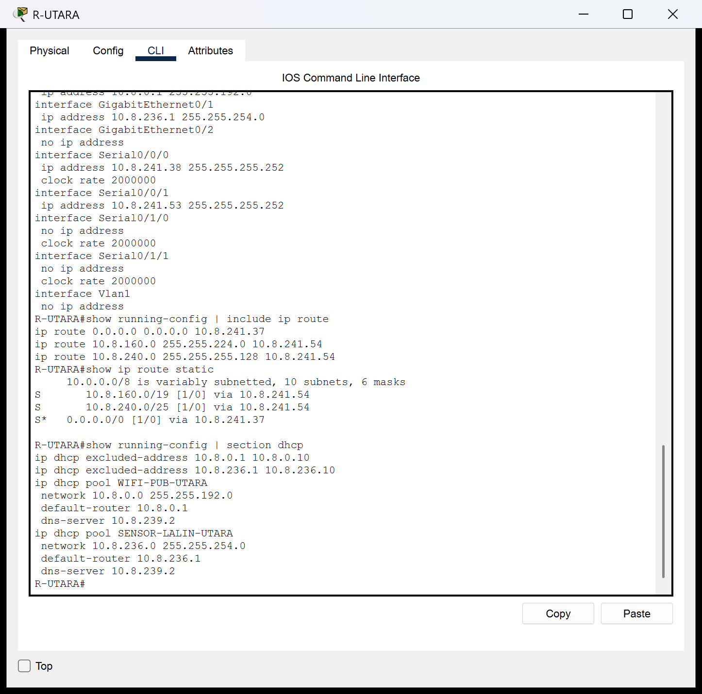](Screenshot/soal-4/cli-utara-dhcp-pool.png) *show run | section dhcp (R-UTARA, 2 pool)*

Router lain memakai pola yang sama (DNS selalu `10.8.239.2`, excluded `.1`–`.10`):

| Router | Pool | `network` | `default-router` |
| --- | --- | --- | --- |
| R-BARAT | `WIFI-PUB-BARAT` | `10.8.192.0 255.255.224.0` | `10.8.192.1` |
| R-BARAT | `PUSKESMAS-BARAT` | `10.8.238.0 255.255.255.0` | `10.8.238.1` |
| R-TIMUR | `WIFI-PUB-TIMUR` | `10.8.128.0 255.255.224.0` | `10.8.128.1` |
| R-TIMUR | `SENSOR-BANJIR-TIMUR` | `10.8.232.0 255.255.252.0` | `10.8.232.1` |
| R-SELATAN | `WIFI-PUB-SELATAN` | `10.8.64.0 255.255.224.0` | `10.8.64.1` |
| R-SELATAN | `PJU-SELATAN` | `10.8.240.128 255.255.255.128` | `10.8.240.129` |
| R-PELABUHAN | `SCADA-PELABUHAN` | `10.8.160.0 255.255.224.0` | `10.8.160.1` |
| R-PELABUHAN | `KANTOR-PELABUHAN` | `10.8.240.0 255.255.255.128` | `10.8.240.1` |

Total **11 pool DHCP router**. LAN Server Balai Kota dan LAN Server & Storage DC **tidak diberi pool** karena isinya server ber-IP statis. LAN CCTV juga **tidak** diberi pool di router (lihat langkah 4).

#### Langkah 4 – DHCP LAN CCTV dari SRV-DC (DHCP relay)

LAN CCTV (`10.8.96.0/19`) dan SRV-DC (`10.8.239.0/24`) berbeda subnet. Broadcast DHCP tidak bisa menyeberang router, jadi **R-DC dijadikan DHCP relay**: permintaan DHCP dari LAN CCTV diteruskan sebagai unicast ke SRV-DC.

**4.1 Relay di R-DC.** Buka CLI **R-DC** → `enable` → `configure terminal`, lalu ketik pada interface yang menghadap LAN CCTV:

```
interface g0/0
ip helper-address 10.8.239.2
```

Simpan: `end` → `copy running-config startup-config`.

[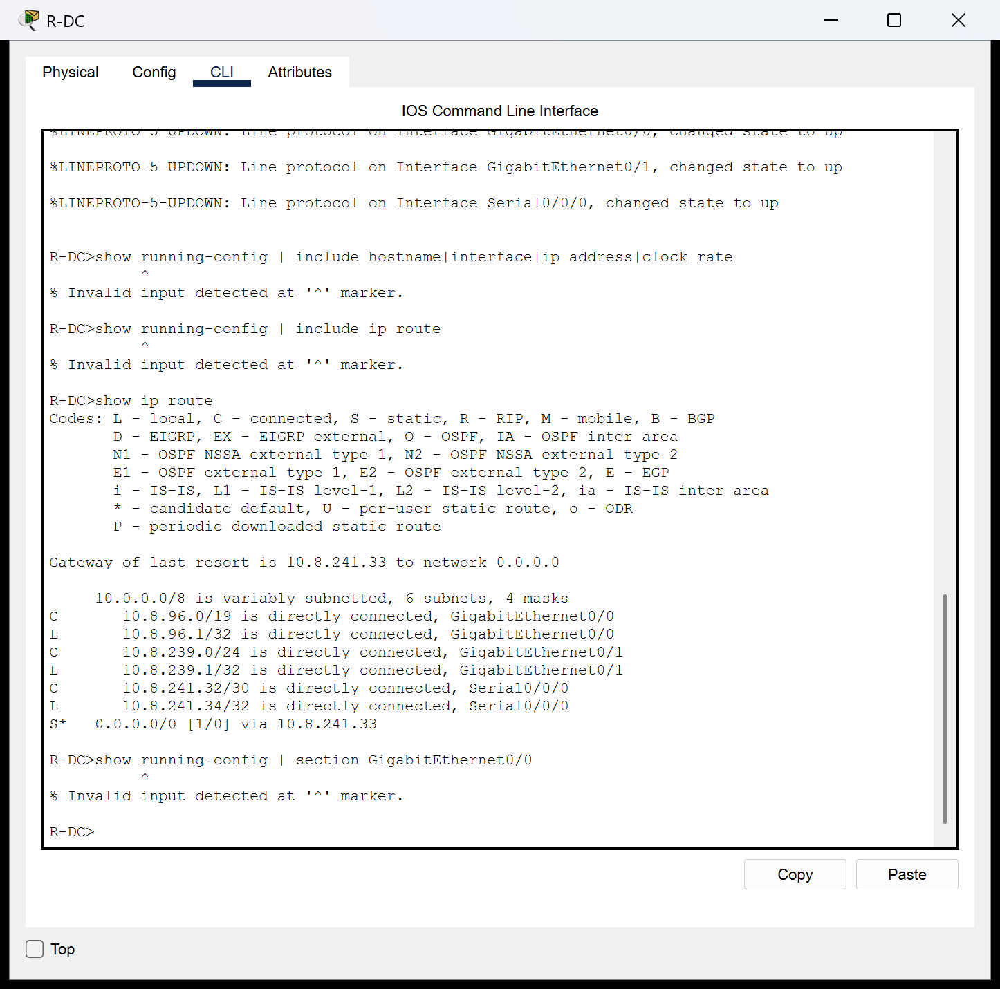](Screenshot/soal-4/cli-dc-helper-address.png) *show run | section G0/0 — ip helper-address 10.8.239.2*

**4.2 Pool di SRV-DC.** Klik **SRV-DC** → tab **Services** → **DHCP**:

1. Hapus pool bawaan `serverPool` (pool default tidak dipakai).
2. Pool `DHCP-CCTV`: Starting IP `10.8.96.11`, Subnet Mask `255.255.255.0`; Default Gateway `10.8.96.1`, DNS Server `10.8.239.2`, **Maximum Users 8180** (kira-kira 60% dari 8.190 alamat valid `/19` sesuai permintaan soal).
3. Klik **Save**, lalu pastikan tombol **On**.

[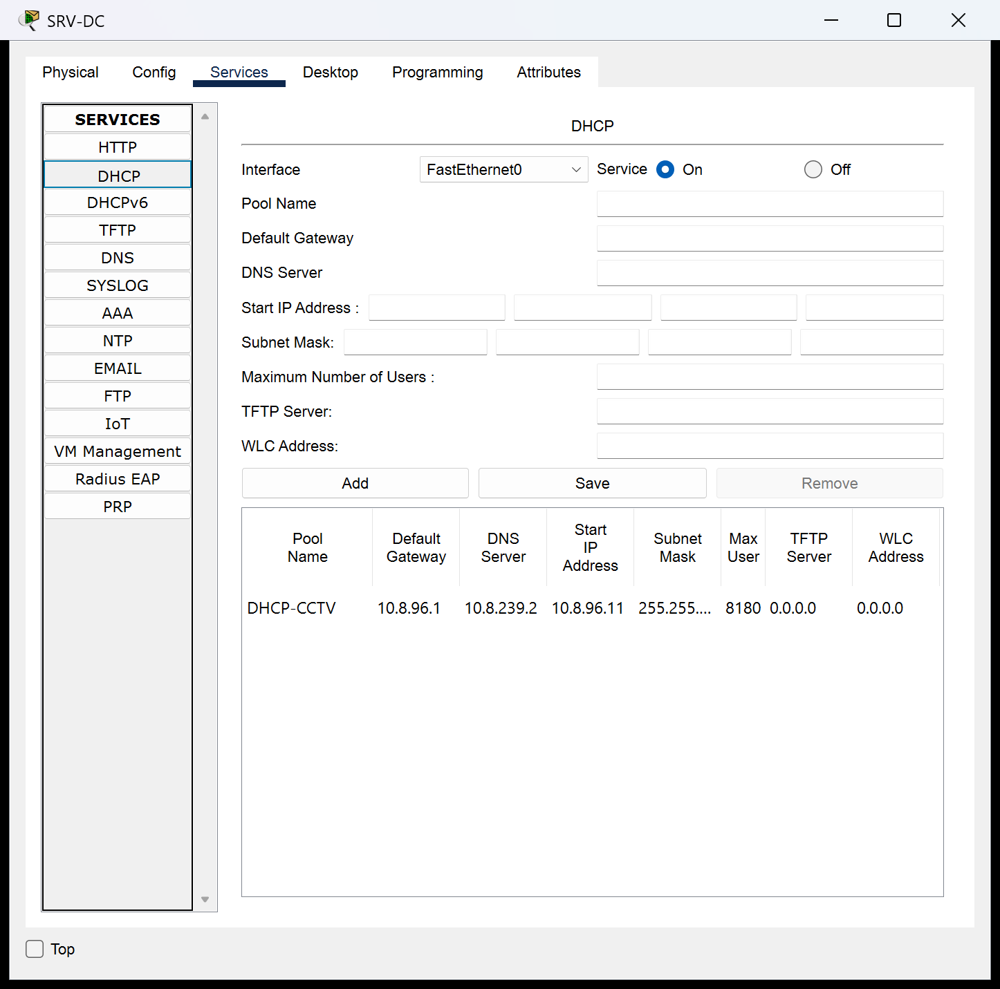](Screenshot/soal-4/bukti-dhcp-cctv-pool.png) *Pool `DHCP-CCTV` di SRV-DC (Services → DHCP).*

### Bukti dan Hasil

1. **Semua PC dapat lease sesuai subnetnya** (Desktop → IP Configuration → DHCP):

| Perangkat | LAN | IP dapat | Gateway | DNS |
| --- | --- | --- | --- | --- |
| PC-PEGAWAI-BK | Pegawai Balai Kota | `10.8.224.x` | `10.8.224.1` | `10.8.239.2` |
| PC-CCTV-KOTA | CCTV Kota | `10.8.96.x` | `10.8.96.1` | `10.8.239.2` |
| PC-PUSKES-BARAT | Puskesmas Barat | `10.8.238.x` | `10.8.238.1` | `10.8.239.2` |
| PC-LALIN-UTARA | Sensor Lalin Utara | `10.8.236.x` | `10.8.236.1` | `10.8.239.2` |
| PC-BANJIR-TIMUR | Sensor Banjir Timur | `10.8.232.x` | `10.8.232.1` | `10.8.239.2` |
| PC-PJU-SELATAN | PJU Pintar Selatan | `10.8.240.13x` | `10.8.240.129` | `10.8.239.2` |
| PC-SCADA-PB | SCADA Pelabuhan | `10.8.160.x` | `10.8.160.1` | `10.8.239.2` |
| PC-KANTOR-PB | Kantor Pelabuhan | `10.8.240.x` | `10.8.240.1` | `10.8.239.2` |

[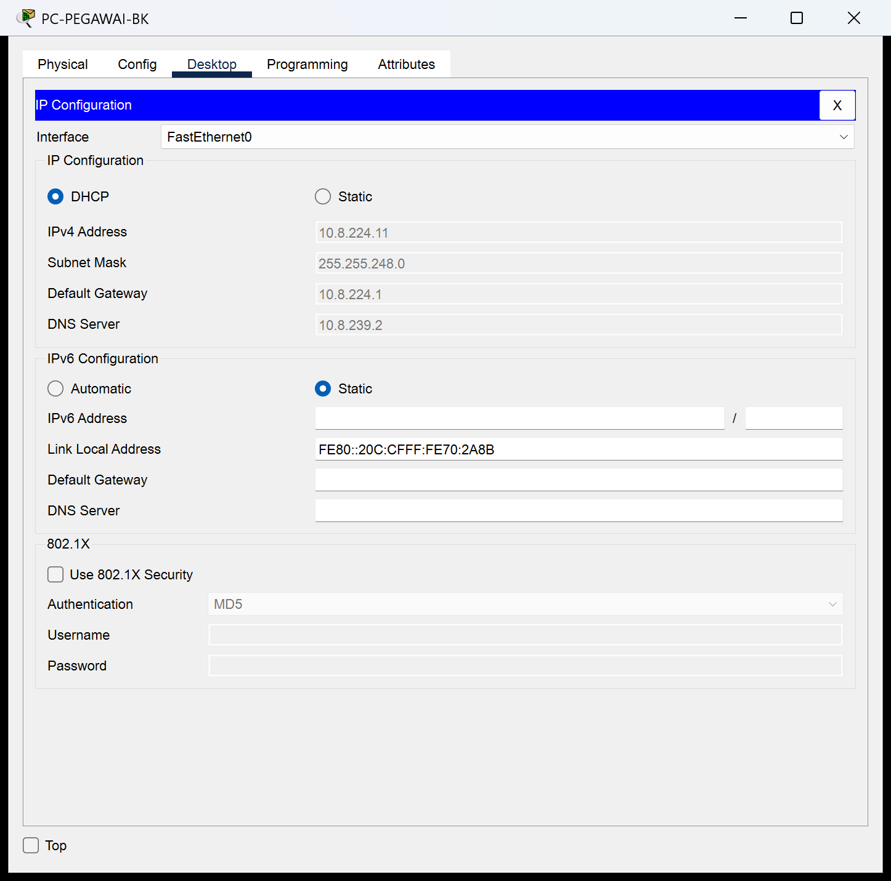](Screenshot/soal-4/bukti-lease-pc-pegawai.png) *① DHCP selected, ② IP `10.8.224.11`.*

[](Screenshot/soal-4/bukti-lease-pc-lalin.png) *PC-LALIN-UTARA: IP `10.8.236.11`, gateway `10.8.236.1`.*

2. **PC-CCTV-KOTA mendapat IP dari SRV-DC, bukan dari pool router** — lease-nya `10.8.96.x` dengan pool `DHCP-CCTV` milik Server-PT (bukti screenshot `bukti-dhcp-cctv-pool.png` di atas).

---

## Soal 5

> Dikerjakan Oleh: **[nama anggota — diisi]**

### Soal

> Seluruh host dapat mengakses server 8.8.8.8 menggunakan satu IP publik milik R-PUSAT. R-ISP tidak boleh memiliki rute ke alamat privat internal.

### Langkah Pengerjaan dan Implementasi

#### Konsep

Tanpa NAT, paket dari PC sampai ke 8.8.8.8, tetapi balasannya ke alamat `10.8.x.x` dibuang di R-ISP karena R-ISP tidak punya rute ke alamat privat. Solusinya **PAT (NAT overload)** di R-PUSAT: semua alamat `10.8.0.0/16` diterjemahkan ke satu IP publik `203.0.113.6` (G0/0), dibedakan dengan nomor port.

- **inside** = semua interface R-PUSAT yang menghadap jaringan internal (2 LAN + 5 serial).
- **outside** = interface ke ISP (G0/0).
- R-ISP **tidak diubah sama sekali**.

#### Langkah 1 – Buka CLI R-PUSAT dan masuk mode konfigurasi

```
enable
configure terminal
```

#### Langkah 2 – Tentukan alamat yang boleh di-NAT

```
ip access-list standard PEGAWAI-SEANGKATAN
permit 10.8.0.0 0.0.255.255
exit
```

Wildcard `0.0.255.255` mencocokkan seluruh `10.8.0.0/16` dalam satu baris (dipakai named standard ACL agar mudah dikenali).

#### Langkah 3 – Tandai interface inside

Masuk ke setiap interface yang menghadap jaringan internal dan ketik `ip nat inside`:

```
interface g0/1
ip nat inside
interface g0/2
ip nat inside
interface s0/0/0
ip nat inside
interface s0/0/1
ip nat inside
interface s0/1/0
ip nat inside
interface s0/1/1
ip nat inside
interface s0/2/0
ip nat inside
```

| Interface | Menghadap |
| --- | --- |
| `g0/1` | LAN Pegawai Balai Kota |
| `g0/2` | LAN Server Balai Kota |
| `s0/0/0` | L1 → R-DC |
| `s0/0/1` | L2 → R-UTARA (termasuk R-PELABUHAN via L6) |
| `s0/1/0` | L3 → R-SELATAN |
| `s0/1/1` | L4 → R-TIMUR |
| `s0/2/0` | L5 → R-BARAT |

#### Langkah 4 – Tandai interface outside

```
interface g0/0
ip nat outside
exit
```

#### Langkah 5 – Aktifkan PAT

```
ip nat inside source list PEGAWAI-SEANGKATAN interface g0/0 overload
```

Artinya: alamat yang cocok dengan ACL `PEGAWAI-SEANGKATAN` diterjemahkan ke IP milik `g0/0`, dan `overload` membuat banyak host berbagi satu IP itu dengan nomor port berbeda.

[](Screenshot/soal-5/cli-pusat-nat.png) *show run | include nat — PAT R-PUSAT*

#### Langkah 6 – Simpan

`end` → `copy running-config startup-config` → Enter.

### Bukti dan Hasil

1. **Konfigurasi NAT tersimpan** – R-PUSAT → `show running-config | include nat`

   [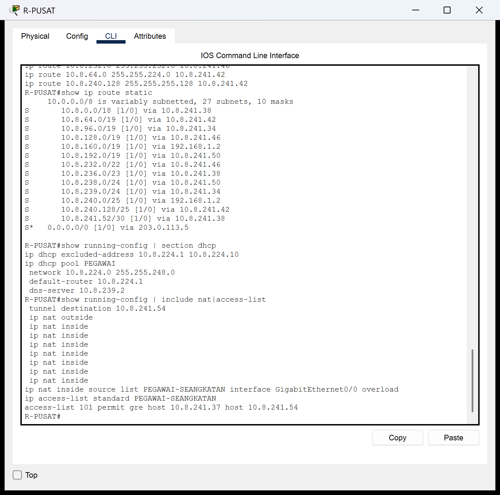](Screenshot/soal-5/bukti-config-nat-pusat.png) *show run | include nat — konfigurasi tersimpan*

2. **Host internal bisa mengakses 8.8.8.8** (setiap gambar: ① balasan dari 8.8.8.8, ② `0% loss`)

   [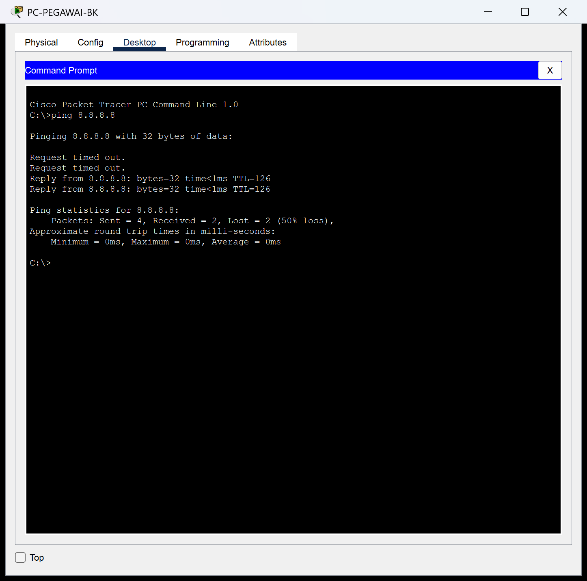](Screenshot/soal-5/bukti-ping-internet-pegawai.png) *① Reply from 8.8.8.8, ② 0% loss.*

3. **Tabel translasi NAT** – R-PUSAT → `show ip nat translations` (setelah ping dari PC internal)

   [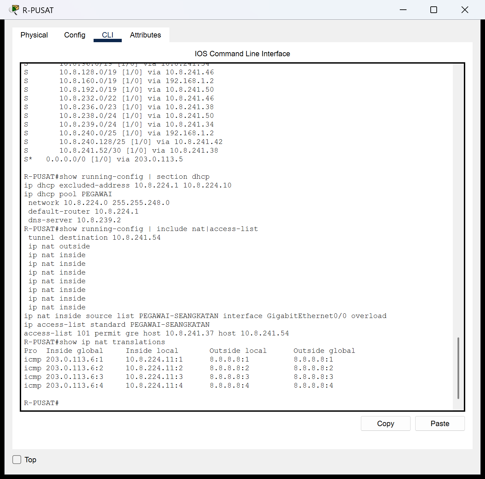](Screenshot/soal-5/bukti-nat-translations.png) *show ip nat translations*

4. **R-ISP tidak punya rute ke alamat privat** – R-ISP → `show ip route`

   [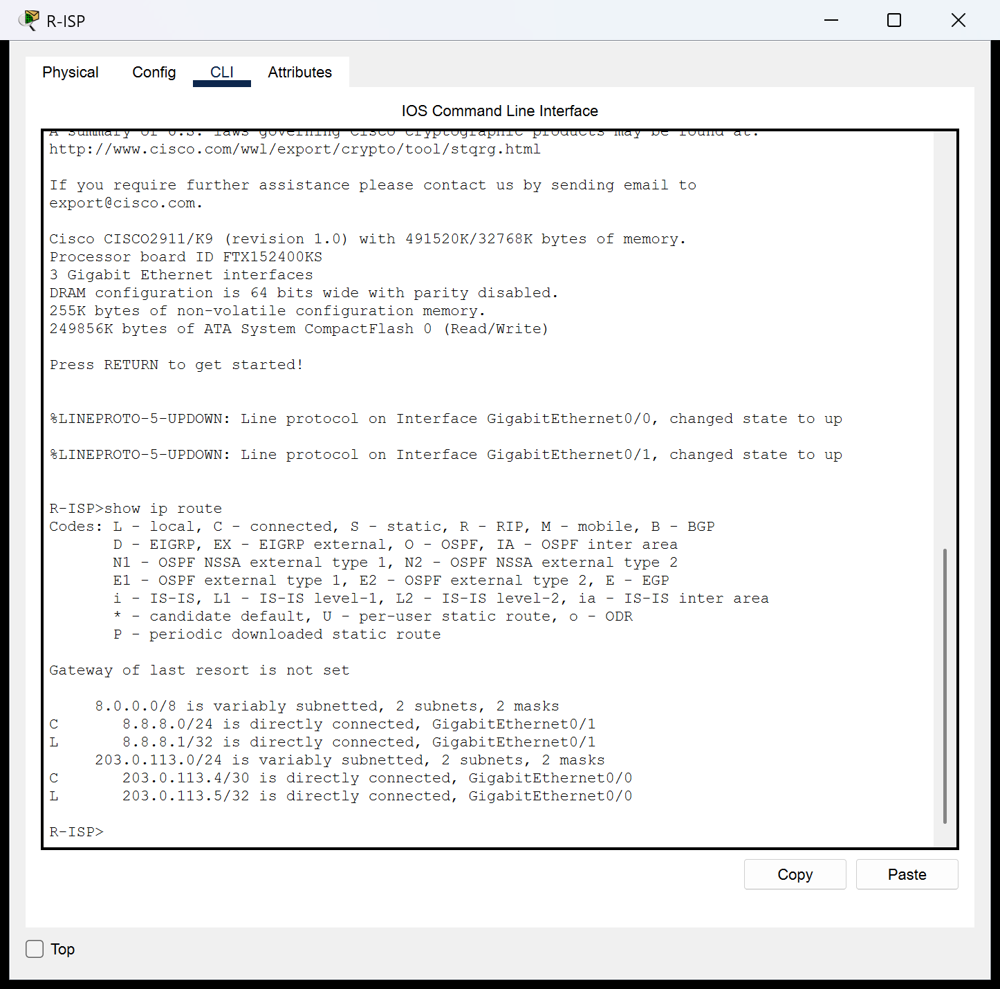](Screenshot/soal-5/bukti-route-isp.png) *show ip route R-ISP — tanpa rute privat*

5. **Uji negatif: internet tidak bisa menjangkau alamat privat** – SRV-INTERNET → `ping 10.8.224.11`

   [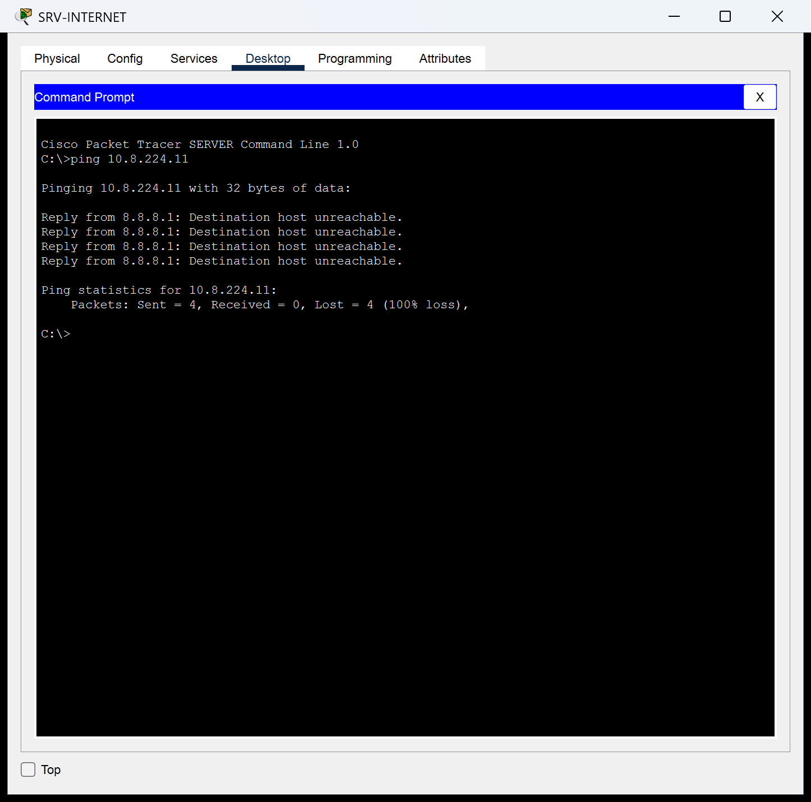](Screenshot/soal-5/ping-internet-ke-privat-gagal.png) *SRV-INTERNET → `ping 10.8.224.11`* — R-ISP membalas `Destination host unreachable` karena tidak punya rute ke `10.8.0.0`, 100% loss. Hasil ini **memang seharusnya gagal**: jaringan internal tidak terekspos ke internet.

6. **Rekap uji akses internet** (ping 4 paket ke `8.8.8.8`): seluruh 11 perangkat pengguna + 2 server (PC-PEGAWAI, PC-CCTV-KOTA, PC-PUSKESMAS, PC-LALIN, PC-BANJIR, PC-PJU, PC-SCADA, PC-KANTOR, HP-WIFI-BARAT/UTARA/TIMUR/SELATAN, SRV-DC, SRV-BALAIKOTA) → **✅ semua**.

---

## Soal 6

> Dikerjakan Oleh: **[nama anggota — diisi]**

### Soal

> Bangun tunnel GRE antara R-PUSAT dan R-PELABUHAN. Lalu lintas antara subnet Balai Kota dan subnet Pelabuhan harus melewati tunnel. Jelaskan mengapa router memilih jalur tunnel dan mengapa GRE saja tidak mengenkripsi data. Bonus (+5): enkripsi IPsec.

### Langkah Pengerjaan dan Implementasi

#### Konsep

- **Mengapa router memilih jalur tunnel**: di kedua ujung dipasang **static route spesifik ke LAN pasangannya dengan next hop = ujung tunnel** (R-PUSAT: LAN Pelabuhan `via 192.168.1.2`; R-PELABUHAN: 2 LAN Balai Kota `via 192.168.1.1`). Static route dengan `/19` dan `/25` **lebih panjang prefix-nya** daripada jalur mana pun, dan static route punya Administrative Distance 1 — selalu menang. Jadi pilihan jalur GRE bersifat deterministik, bukan best-effort.
- **Mengapa GRE saja tidak mengenkripsi**: GRE hanya **meng-encapsulasi** paket (menambah header baru) supaya bisa diangkut melewati jaringan lain; isi tetap terbaca siapa pun yang menangkap linknya. Enkripsi dibutuhkan → IPsec (Bonus, bagian C di bawah).

#### Langkah 1 – Interface tunnel di R-PUSAT

Buka CLI **R-PUSAT** → `enable` → `configure terminal`:

```
interface Tunnel0
ip address 192.168.1.1 255.255.255.252
tunnel source Serial0/0/1
tunnel destination 10.8.241.54
exit
```

| Perintah | Fungsi |
| --- | --- |
| `interface Tunnel0` | membuat interface tunnel GRE (bawaan IOS 15.1, tanpa modul tambahan) |
| `ip address 192.168.1.1 255.255.255.252` | IP tunnel subnet `192.168.1.0/30` |
| `tunnel source Serial0/0/1` | interface fisik L2 (IP `10.8.241.37`) jadi sumber GRE |
| `tunnel destination 10.8.241.54` | IP fisik R-PELABUHAN (S0/0/0, L6) |

Tunnel0 **jangan** diberi `ip nat inside/outside`: lalu lintas Balai Kota ↔ Pelabuhan lewat tunnel tidak keluar G0/0, jadi tidak di-NAT.

#### Langkah 2 – Interface tunnel di R-PELABUHAN

```
interface Tunnel0
ip address 192.168.1.2 255.255.255.252
tunnel source Serial0/0/0
tunnel destination 10.8.241.37
exit
```

Pasangan (source, destination) kedua ujung harus **saling mencerminkan** dan referensinya lengkap di routing (rute ke `10.8.241.52/30` sudah ada di R-PUSAT dari soal 3; R-PELABUHAN mencapai `10.8.241.37` via default → agar tunnel stabil, rute ini ikut dipelajari; Tunnel0 keduanya `up/up`).

#### Langkah 3 – Simpan dan uci tunnel

Kedua ujung: `end` → `copy running-config startup-config`.

[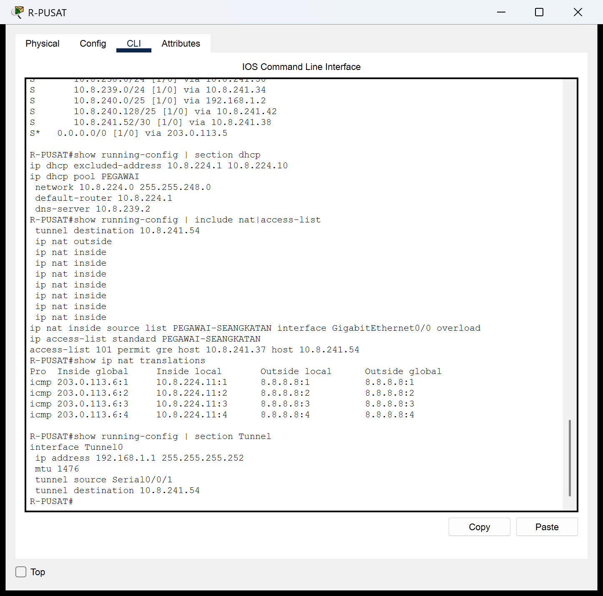](Screenshot/soal-6/cli-pusat-tunnel.png) *show run | section Tunnel — interface Tunnel0*

#### Langkah 4 – Bonus IPsec (+5)

PT 9.0.1 tidak mengenali `crypto ipsec profile` / `tunnel protection`, jadi proteksi memakai **crypto map klasik** yang di-apply di interface sumber tunnel kedua router:

**4.1 Aktifkan lisensi securityk9** (kedua router):

```
license boot module c2900 technology-package securityk9
ACCEPT? [yes/no]: yes
end
write
```

Lalu *reload* (mati-nyalakan router) → `show license feature` menunjukkan securityk9 **Enabled = yes**.

[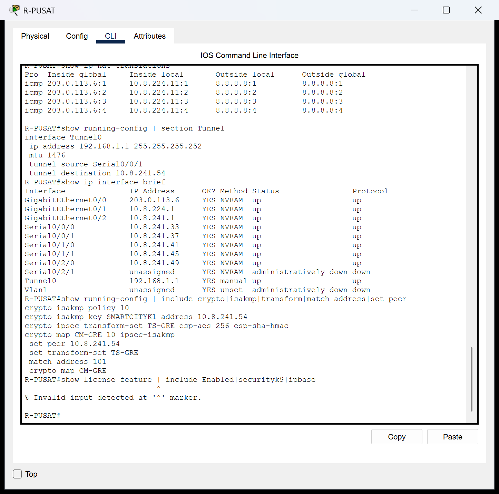](Screenshot/soal-6/bukti-license-feature.png) *show license feature — securityk9 yes*

**4.2 ISAKMP (phase 1) + transform-set (phase 2) + crypto map — R-PUSAT:**

```
crypto isakmp policy 10
 encr aes 256
 hash sha
 authentication pre-share
 group 2
exit
crypto isakmp key SMARTCITYK1 address 10.8.241.54
crypto ipsec transform-set TS-GRE esp-aes 256 esp-sha-hmac
access-list 101 permit gre host 10.8.241.37 host 10.8.241.54
crypto map CM-GRE 10 ipsec-isakmp
 set peer 10.8.241.54
 set transform-set TS-GRE
 match address 101
exit
interface Serial0/0/1
 crypto map CM-GRE
end
write
```

**4.3 R-PELABUHAN (cermin):**

```
crypto isakmp key SMARTCITYK1 address 10.8.241.37
access-list 101 permit gre host 10.8.241.54 host 10.8.241.37
crypto map CM-GRE 10 ipsec-isakmp
 set peer 10.8.241.37
 set transform-set TS-GRE
 match address 101
exit
interface Serial0/0/0
 crypto map CM-GRE
end
write
```

[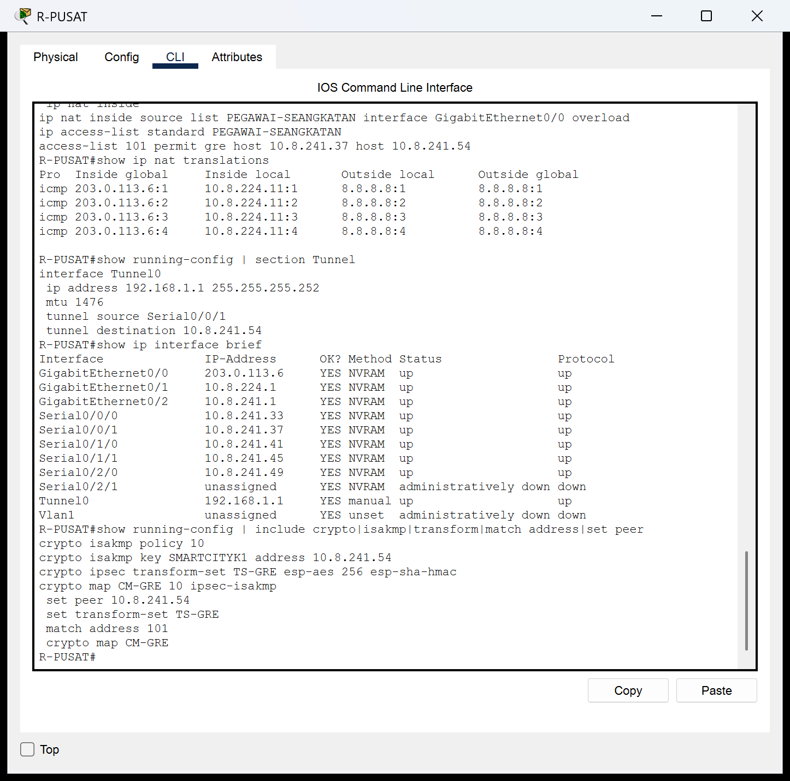](Screenshot/soal-6/cli-crypto-pusat.png) *show run — ISAKMP + crypto map CM-GRE*

### Bukti dan Hasil

1. **Tunnel up** – kedua ujung `show ip interface brief` → Tunnel0 `up/up`.

   [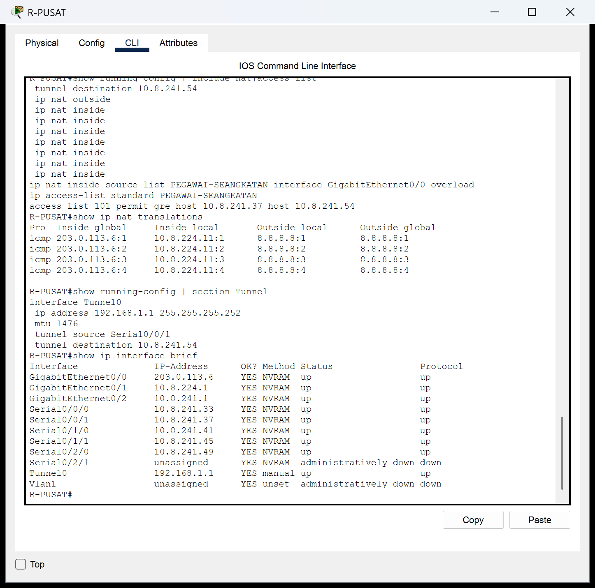](Screenshot/soal-6/bukti-tunnel-up.png) *show ip int brief — Tunnel0 up/up (R-PUSAT)*

2. **Lalu lintas Balai Kota ↔ Pelabuhan lewat tunnel** – PC-PEGAWAI (Balai Kota) → `tracert 10.8.240.11` (PC-KANTOR-PB): hop-1 `10.8.224.1` (gateway), **hop-2 `192.168.1.2`** (Tunnel GRE), hop-3 tujuan.

   [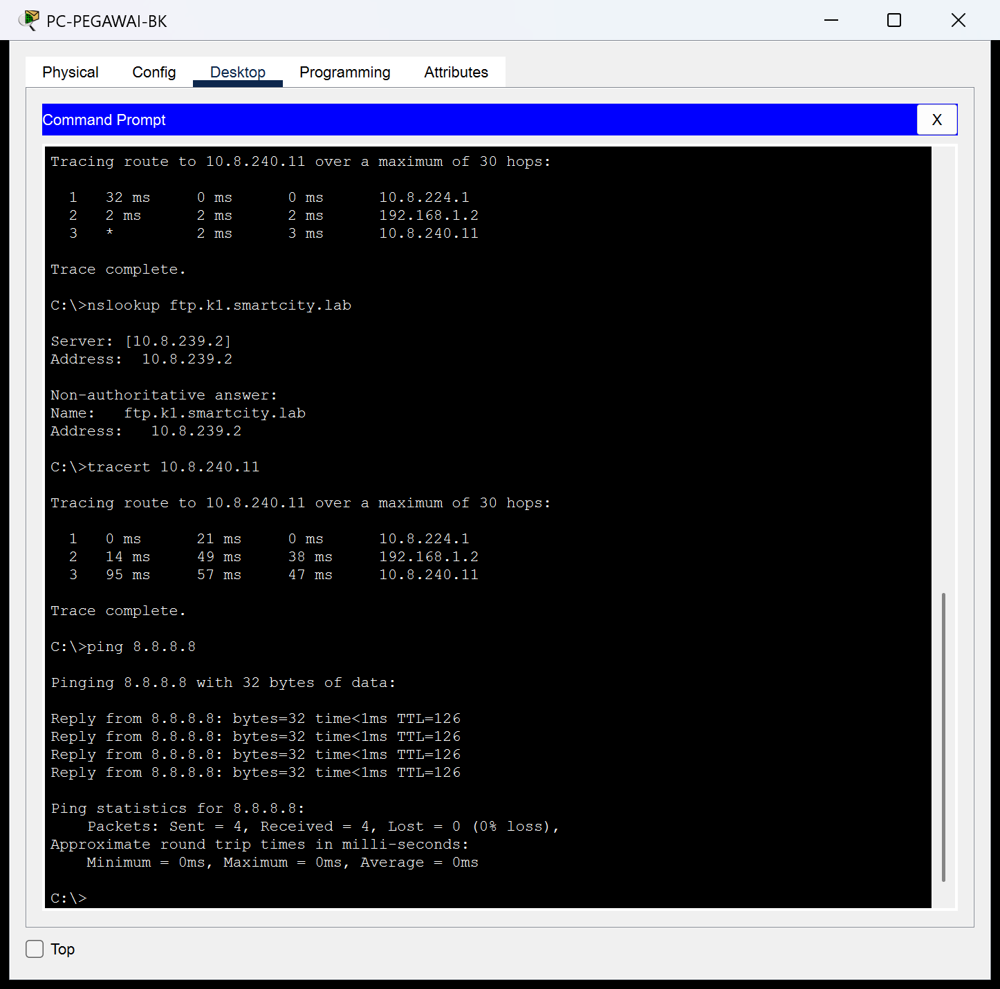](Screenshot/soal-6/bukti-tracert-tunnel.png) *① hop-2 = 192.168.1.2 membuktikan jalur tunnel, ② tujuan 10.8.240.11.*

3. **Bonus IPsec**:
   - `show crypto map` di kedua router → map `CM-GRE` terpasang di interface sumber tunnel dengan peer, transform-set, dan match address yang benar.

     [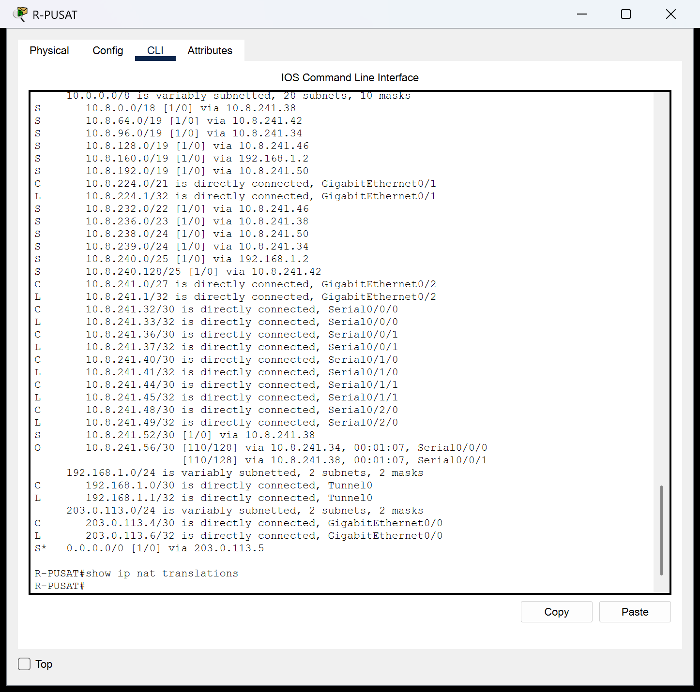](Screenshot/soal-6/bukti-crypto-map.png)

   - `show crypto isakmp sa` → status **QM_IDLE ACTIVE** (IKE berhasil negosiasi).

     [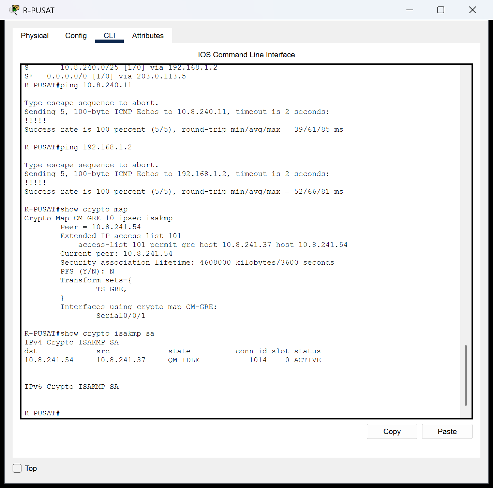](Screenshot/soal-6/bukti-isakmp-sa.png) *① state QM_IDLE, ② ACTIVE.*

   - `show crypto ipsec sa` → penghitung `#pkts encrypt` dan `#pkts decaps` bertambah setiap ping lintas tunnel: isi GRE benar-benar terenkripsi AES-256 + SHA-1.

     [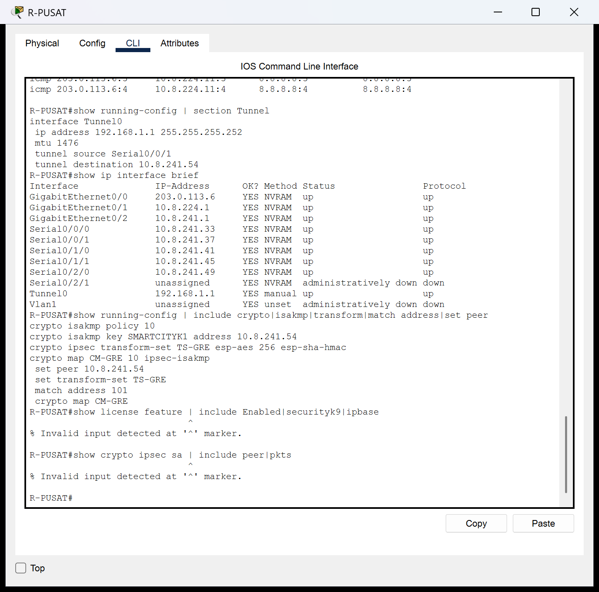](Screenshot/soal-6/bukti-ipsec-sa-pkts.png) *show crypto ipsec sa — counter pkts encrypt*

   - Ping tunnel tetap 100% → enkripsi tidak merusak konektivitas.

---

## Soal 7

> Dikerjakan Oleh: **[nama anggota — diisi]**

### Soal

> Kerjakan di file terpisah. Tambahkan link cadangan L7 antara R-DC dan R-UTARA dengan alamat yang belum digunakan. Ganti seluruh static route antar-router dengan OSPF: router tidak mengirim pesan OSPF ke LAN pengguna, default route hanya dikonfigurasi di R-PUSAT dan disebarkan lewat OSPF, dan konektivitas pulih otomatis jika satu link backbone putus.

### Langkah Pengerjaan dan Implementasi

Dikerjakan di file terpisah **`K1_VLSM_OSPF.pkt`** (salinan penuh dari `K1_VLSM.pkt` + perubahan berikut).

#### Langkah 1 – Link cadangan L7

R-DC masih punya S0/0/1 kosong; R-UTARA memakai S0/1/0 (dari 2× HWIC-2T). Kabel serial DCE di sisi **R-DC**:

| Link | Network | R-DC (DCE, clock 64000) | R-UTARA |
| --- | --- | --- | --- |
| L7 | `10.8.241.56/30` | S0/0/1 = `.57` | S0/1/0 = `.58` |

```
! R-DC
interface s0/0/1
ip address 10.8.241.57 255.255.255.252
clock rate 64000
no shutdown

! R-UTARA
interface s0/1/0
ip address 10.8.241.58 255.255.255.252
no shutdown
```

[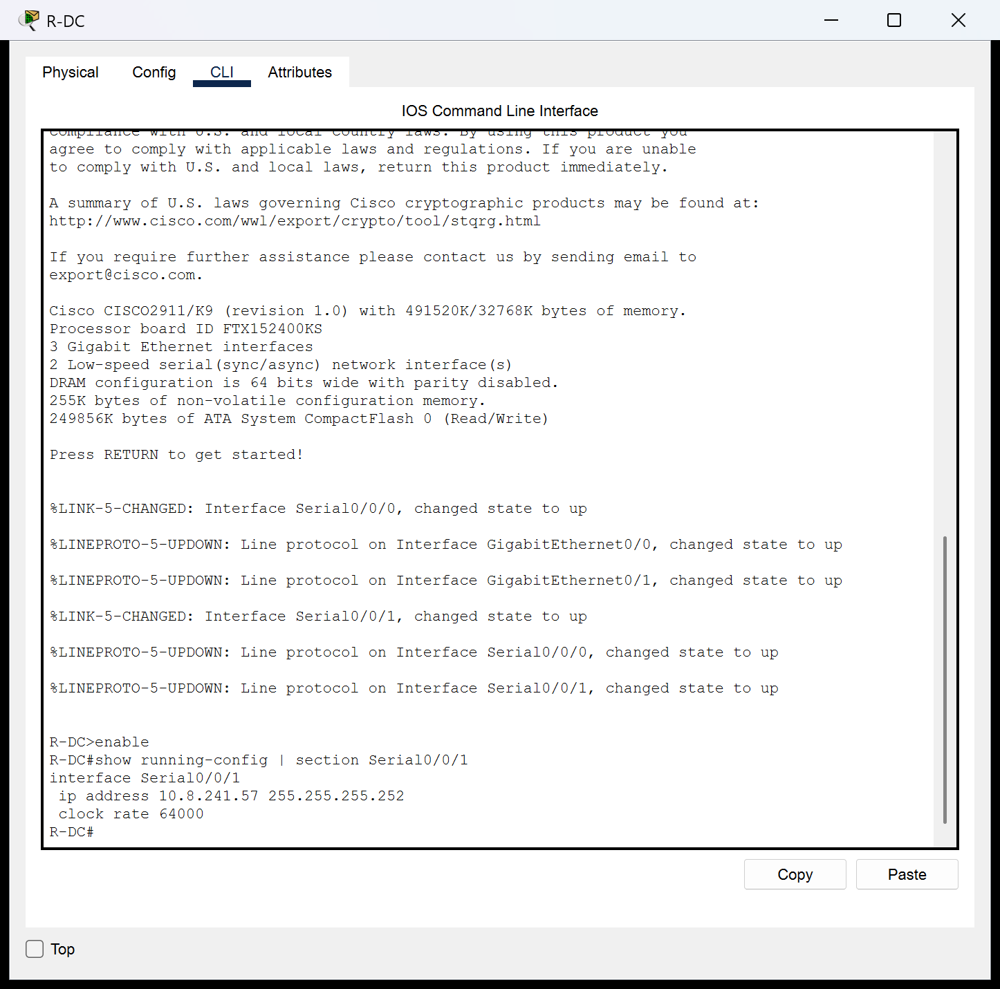](Screenshot/soal-7/cli-l7-dc-utara.png) *R-DC — konfigurasi Serial0/0/1 (L7)*

#### Langkah 2 – Hapus seluruh static route antar-router

Di R-PUSAT dihapus 13 static internal + rute L6; di R-UTARA dihapus 2 static ke Pelabuhan. Perintah penghapusannya dengan awalan `no` (tanpa `no`, perintah yang sama justru menambah rute duplikat — lihat [Kendala & Solusi](#kendala--solusi)):

```
no ip route 10.8.96.0 255.255.224.0 10.8.241.34
no ip route 10.8.239.0 255.255.255.0 10.8.241.34
! ... dan seterusnya untuk 11 rute lain di R-PUSAT, serta 2 rute di R-UTARA
end
write
```

**Dipertahankan**: default (`S*`) di tiap router dan **2 static route GRE-forced** di R-PUSAT (LAN Pelabuhan `via 192.168.1.2`) serta R-PELABUHAN (2 LAN Balai Kota `via 192.168.1.1`) — sesuai ketentuan soal 6 yang tetap berlaku di file OSPF.

#### Langkah 3 – OSPF process 1 Area 0 (semua router internal)

Pola (contoh R-PUSAT, router-id 1.1.1.1):

```
router ospf 1
 router-id 1.1.1.1
 network 10.8.224.0 0.0.7.255 area 0
 network 10.8.241.0 0.0.0.31 area 0
 network 10.8.241.32 0.0.0.3 area 0
 network 10.8.241.36 0.0.0.3 area 0
 network 10.8.241.40 0.0.0.3 area 0
 network 10.8.241.44 0.0.0.3 area 0
 network 10.8.241.48 0.0.0.3 area 0
 passive-interface GigabitEthernet0/1
 passive-interface GigabitEthernet0/2
 default-information originate
end
write
```

| Router | router-id | catatan |
| --- | --- | --- |
| R-PUSAT | `1.1.1.1` | `default-information originate` + passive kedua LAN |
| R-DC | `2.2.2.2` | network L1 **dan L7** |
| R-BARAT | `3.3.3.3` | |
| R-UTARA | `4.4.4.4` | network L2, **L6, dan L7** |
| R-TIMUR | `5.5.5.5` | |
| R-SELATAN | `6.6.6.6` | |
| R-PELABUHAN | `7.7.7.7` | |

`passive-interface` diberikan pada **semua interface LAN pengguna** (syarat soal: router tidak mengirim hello OSPF ke LAN), sehingga adjacency hanya terbentuk di port serial backbone.

#### Langkah 4 – Default route disebarkan lewat OSPF

Default route fisik hanya ada di R-PUSAT (`ip route 0.0.0.0 0.0.0.0 203.0.113.5`). Perintah `default-information originate` mengiklankannya ke OSPF → seluruh cabang punya default rute sebagai `O*E2 0.0.0.0/0` tanpa mengetahui rute menjelang ISP secara static.

R-ISP **tetap tidak diikutkan OSPF** dan tidak diberi rute privat (syarat soal 5 tetap terjaga).

### Bukti dan Hasil

1. **Adjacency penuh** – R-PUSAT → `show ip ospf neighbor`: 5 tetangga **FULL** (R-DC 2.2.2.2, R-UTARA 4.4.4.4, R-SELATAN 6.6.6.6, R-TIMUR 5.5.5.5, R-BARAT 3.3.3.3). R-UTARA membentuk 3 adjacency (R-PUSAT, R-PELABUHAN 7.7.7.7, R-DC 2.2.2.2 via L7).

   [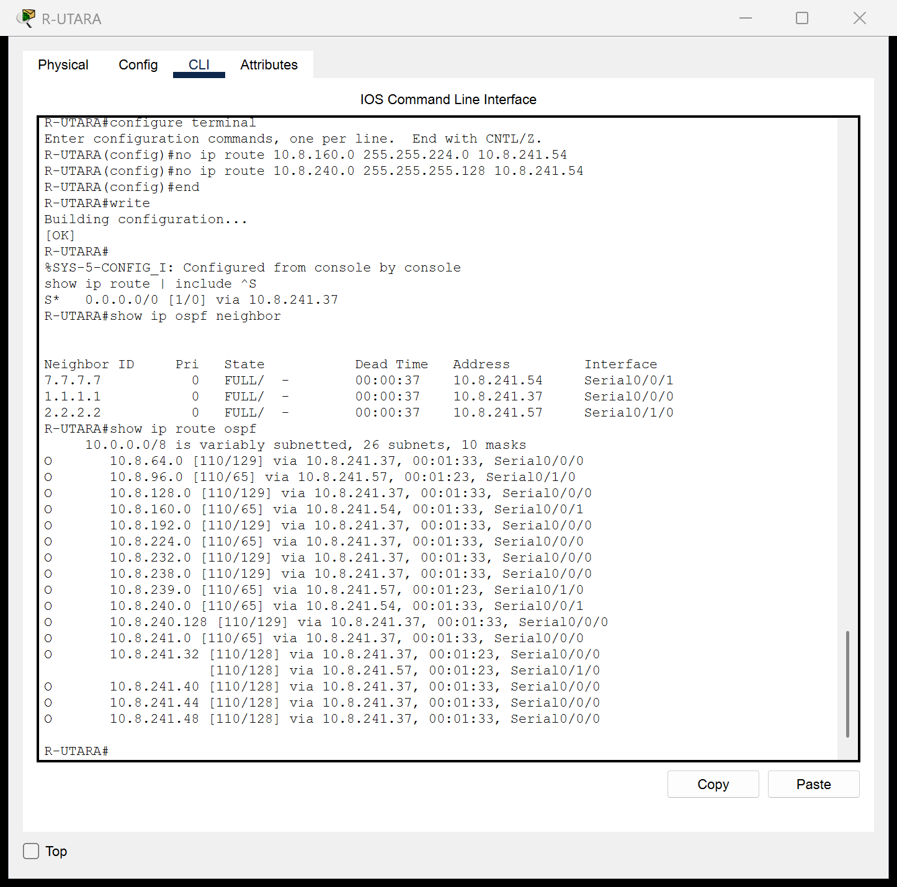](Screenshot/soal-7/bukti-neighbor-route-utara.png) *① 3 tetangga FULL termasuk 7.7.7.7 dan 2.2.2.2, ② rute OSPF yang dipelajari.*

2. **Tabel routing bersih** – R-PUSAT → `show ip route | include S`: hanya `S* 0.0.0.0/0 via 203.0.113.5` + 2 static GRE-forced `via 192.168.1.2`; sisanya rute OSPF (`O`) dan connected (`C`).

   [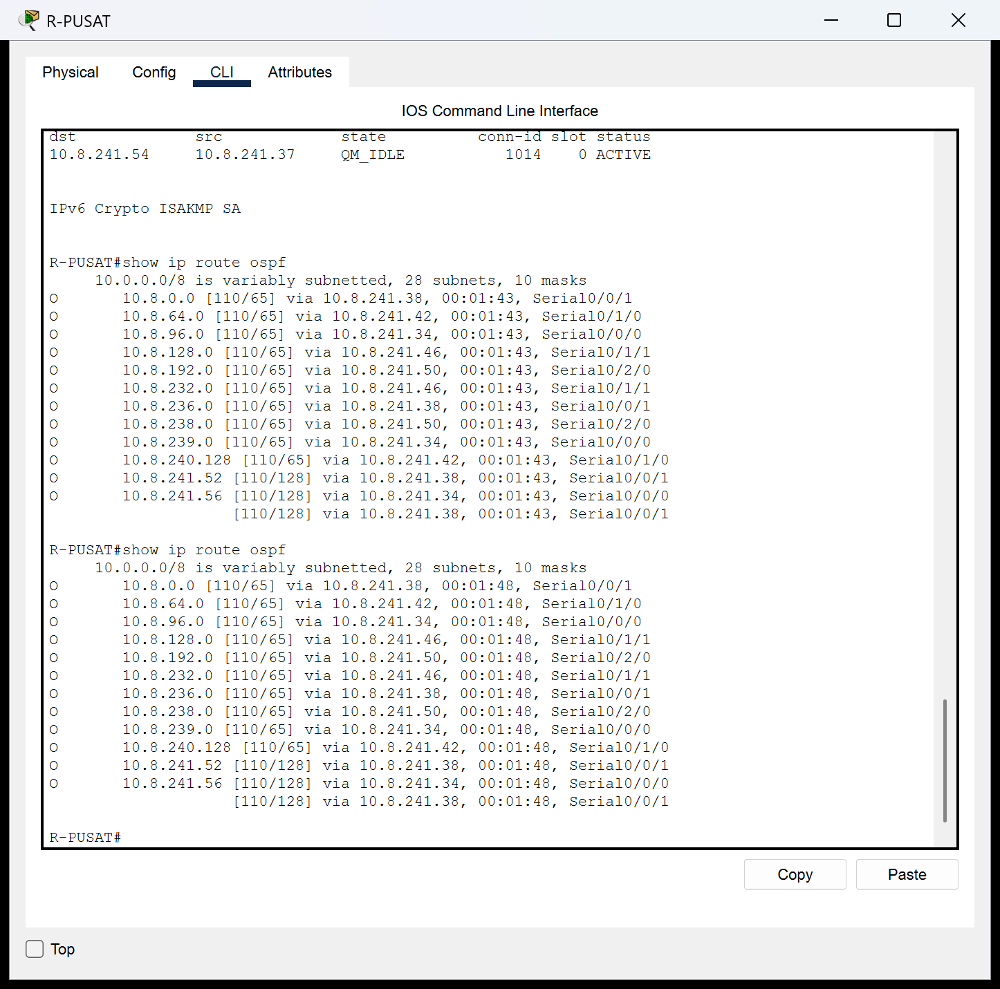](Screenshot/soal-7/bukti-route-ospf-pusat.png)

3. **Default tersebar lewat OSPF** – cabang mana pun menampilkan `O*E2 0.0.0.0/0 [110/1]`.

   [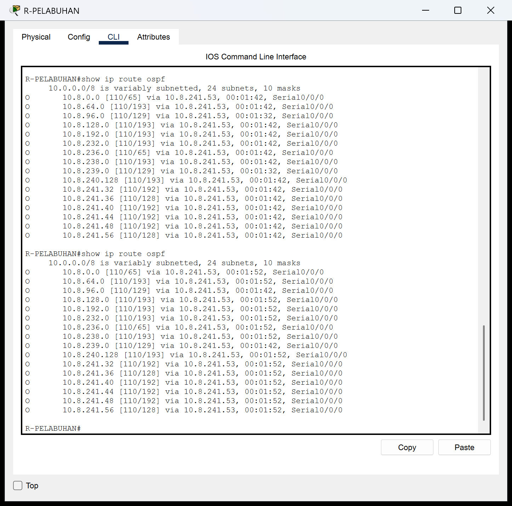](Screenshot/soal-7/bukti-route-ospf-pelabuhan.png)

4. **Failover otomatis** — uji: shutdown L1 (R-PUSAT S0/0/0), semua traffic R-DC dialihkan otomatis **via 10.8.241.58 (L7)** dalam hitungan detik, ping antar-LAN tetap hidup; `no shutdown` → jalur kembali normal.

   [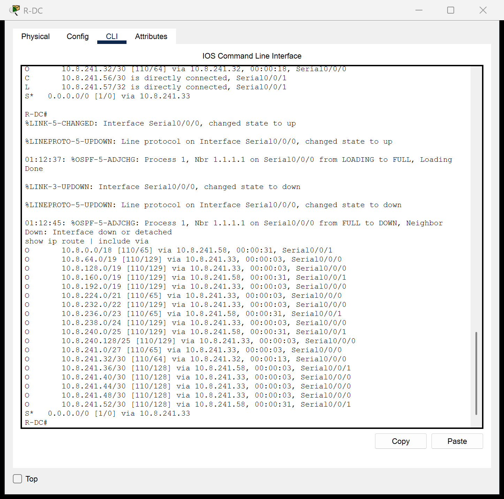](Screenshot/soal-7/bukti-failover-l7.png) *R-DC saat L1 down — rute via 10.8.241.58 (L7)*

---

## Soal 8

> Dikerjakan Oleh: **[nama anggota — diisi]**

### Soal

> Gunakan domain internal `k1.smartcity.lab`. DNS di LAN Server dan Storage DC, Web "Portal Smart City Surabaya" di LAN Server Balai Kota, FTP di LAN Server dan Storage DC dengan akun login (CCTV dapat upload), serta email antarpegawai Balai Kota dan Pelabuhan.

### Langkah Pengerjaan dan Implementasi

#### Langkah 1 – DNS di SRV-DC (10.8.239.2)

Klik **SRV-DC** → tab **Services** → **DNS** → **On**, lalu tambahkan 3 A-Record:

| Name | Type | Address |
| --- | --- | --- |
| `www.k1.smartcity.lab` | A Record | `10.8.239.2` |
| `mail.k1.smartcity.lab` | A Record | `10.8.239.2` |
| `ftp.k1.smartcity.lab` | A Record | `10.8.239.2` |

Semua DNS klien sudah diset oleh DHCP dari soal 4 (`dns-server 10.8.239.2`), jadi tidak perlu konfigurasi tambahan di PC.

[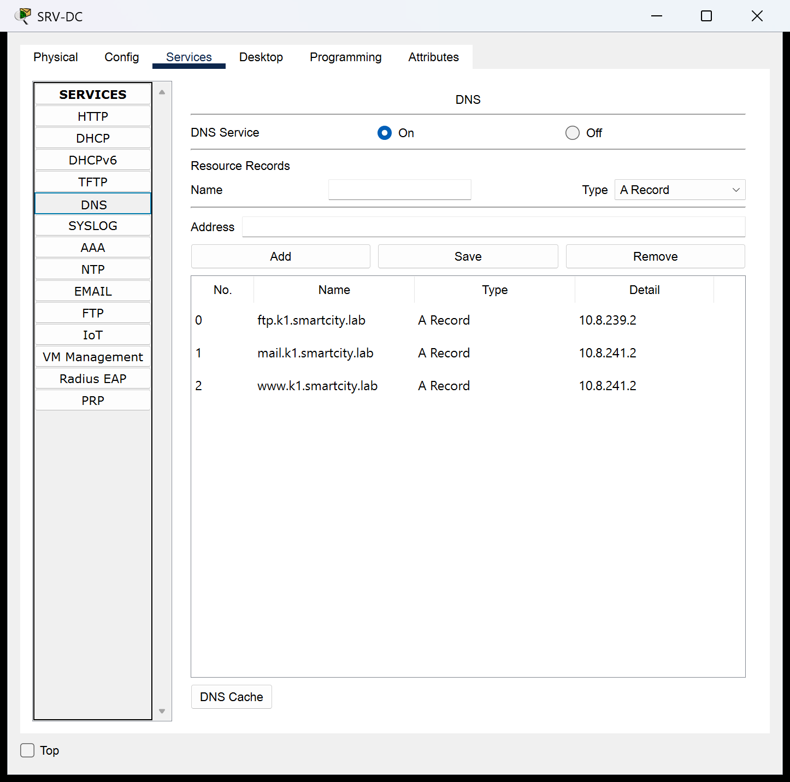](Screenshot/soal-8/bukti-dns-records.png) *① DNS On, ② tiga A Record k1.smartcity.lab.*

#### Langkah 2 – Web portal di SRV-BALAIKOTA (10.8.241.2)

Klik **SRV-BALAIKOTA** → tab **Services** → **HTTP**: mode **HTTP on** (HTTPS cukup off), lalu edit `index.html` menjadi halaman portal "Portal Smart City Surabaya – Kelompok 1".

[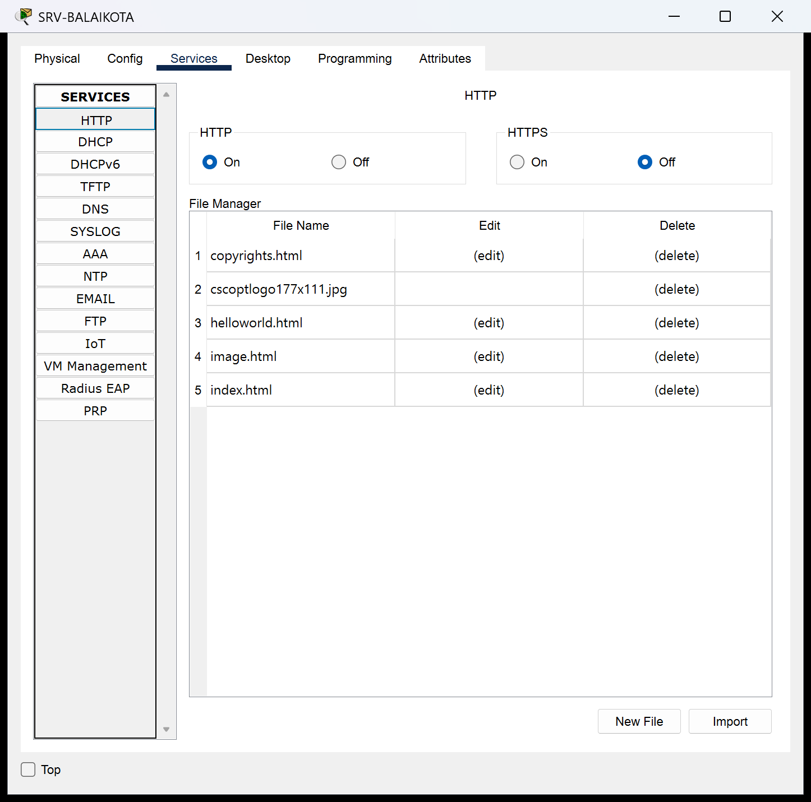](Screenshot/soal-8/bukti-portal-http.png) *① HTTP On, ② index.html portal Smart City.*

#### Langkah 3 – FTP di SRV-DC

Klik **SRV-DC** → tab **Services** → **FTP** → **On**:

| Username | Password | Hak akses |
| --- | --- | --- |
| `cctv1` | `cctv123` | RWDNL (bisa tulis/upload — untuk PC-CCTV-KOTA) |
| bawaan | — | user lain dibiarkan default |

(SRV-BALAIKOTA FTP di-**Off**; FTP memang semestinya di LAN Server & Storage DC.)

#### Langkah 4 – Email di SRV-BALAIKOTA

Klik **SRV-BALAIKOTA** → tab **Services** → **EMAIL**: SMTP & POP3 **On**, domain `k1.smartcity.lab`, akun:

| User | Password |
| --- | --- |
| `andi` (PC-PEGAWAI-BK, Balai Kota) | `andi123` |
| `budi` (PC-KANTOR-PB, Kantor Pelabuhan) | `budi123` |

**Client di PC** — Desktop → Email: isi Your Name, Email (`andi@k1.smartcity.lab`), Incoming POP3 `10.8.241.2`, Outgoing SMTP `10.8.241.2`, Logon username/password, klik **Save**. Ulangi di PC-KANTOR-PB dengan akun `budi`.

[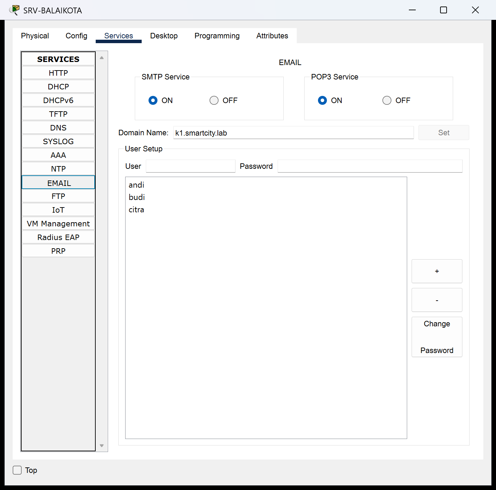](Screenshot/soal-8/bukti-email-konfigurasi-client.png) *① alamat email client, ② server POP3/SMTP, ③ tombol Save.*

[](Screenshot/soal-8/bukti-akun-email-srv.png) *① SMTP/POP3 On, ② akun andi dan budi, ③ domain k1.smartcity.lab.*

### Bukti dan Hasil

1. **DNS bekerja** – PC-PEGAWAI-BK → `nslookup ftp.k1.smartcity.lab` → `10.8.239.2` dari server `10.8.239.2`.

   [](Screenshot/soal-8/bukti-nslookup.png)

2. **Portal dibuka via nama domain** – browser PC → `http://www.k1.smartcity.lab` → halaman "Portal Smart City Surabaya – Kelompok 1".

   [](Screenshot/soal-8/bukti-browser-portal.png) *Portal dibuka via http://www.k1.smartcity.lab.*

3. **FTP login + upload dari LAN CCTV** – PC-CCTV-KOTA → `ftp ftp.k1.smartcity.lab` (username `cctv1`, password `cctv123`) → `put sampleFile.txt` → **Transfer complete** (26 byte), file terdaftar di server (`dir`).

   [](Screenshot/soal-8/bukti-ftp-upload.png)

   [](Screenshot/soal-8/bukti-ftp-server-filelist.png)

4. **Email antarpegawai Balai Kota ↔ Pelabuhan** – PC-PEGAWAI-BK (andi) Compose → `budi@k1.smartcity.lab` → **Send** → status `sent to budi@k1.smartcity.lab`; di PC-KANTOR-PB, budi klik **Receive** → surat tampil di inbox.

   [](Screenshot/soal-8/bukti-email-inbox-budi.png) *① pesan dari andi@k1.smartcity.lab, ② isi surat.*

   [](Screenshot/umum/email-send-status.png) *Status `sent to budi@k1.smartcity.lab` di sisi pengirim.*

---

## Kendala & Solusi

| Kendala | Penyebab | Solusi |
| --- | --- | --- |
| Router-PT tidak bisa membuat GRE/IPsec | IOS 12.2 PT1000 tidak punya `interface Tunnel`; `crypto ?` hanya berisi `key` | Semua router diganti **Cisco 2911 + HWIC-2T** sesuai modul dosen |
| HP WiFi tersambung ke AP wilayah lain | Semua AP memakai SSID bawaan `Default` | SSID unik per wilayah di AP (Port 1) dan smartphone (Wireless0) |
| `license boot module ... securityk9` terlihat gagal | Muncul **EULA interaktif** `ACCEPT? [yes/no]` yang harus dijawab di sesi CLI yang sama; lisensi baru aktif setelah `write` + reload | Jawab `yes`, `write`, lalu mati-nyalakan router; `show license feature` → Enabled = yes |
| `crypto ipsec profile` / `tunnel protection` ditolak `% Invalid input` | Parser PT 9.0.1 tidak mengenali fitur tersebut (IOS sesungguhnya mengenalnya) | Proteksi memakai **crypto map klasik** (`CM-GRE` + ACL 101 `permit gre`) di interface sumber tunnel kedua router — hasil sama: IPsec berjalan (QM_IDLE ACTIVE, pkts terenkripsi) |
| Static route "dihapus" tapi malah muncul ganda | Mengetik `ip route ...` tanpa awalan `no` = perintah *add* | Pakai `no ip route <net> <mask> <nh>`; verifikasi `show ip route \| include ^S` |
| Perintah `show` ditolak di CLI (`% Invalid input`) | Mengklik interface di tab Config membuat console masuk mode `(config-if)#` | Ketik `end` dulu |
| Ping pertama `Request timed out` | Proses ARP pada paket pertama | Ulangi ping |
| Surat email tidak tampil di inbox bila diteruskan via skrip | Mail Browser PT 9.0.1 hanya menggambar inbox saat tombol **Receive** diklik manual | Klik **Receive** manual di PC-KANTOR-PB (SMTP *send* via otomasi tetap sukses) |

---

> Terakhir diperbarui: 28 Oktober 2026 — file(Packet Tracer): `K1_VLSM.pkt` (soal 1–6) dan `K1_VLSM_OSPF.pkt` (soal 7) berada di root repo ini.
